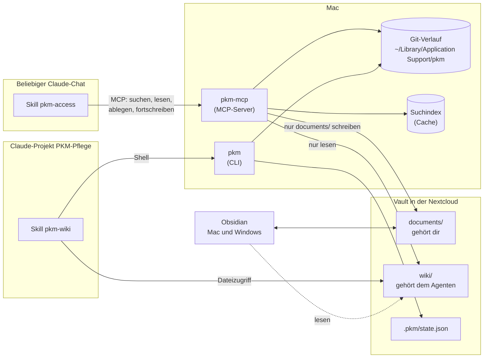
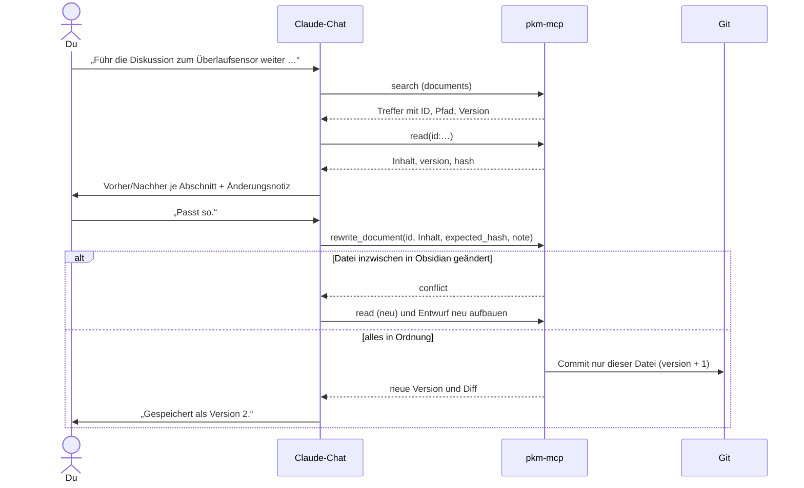
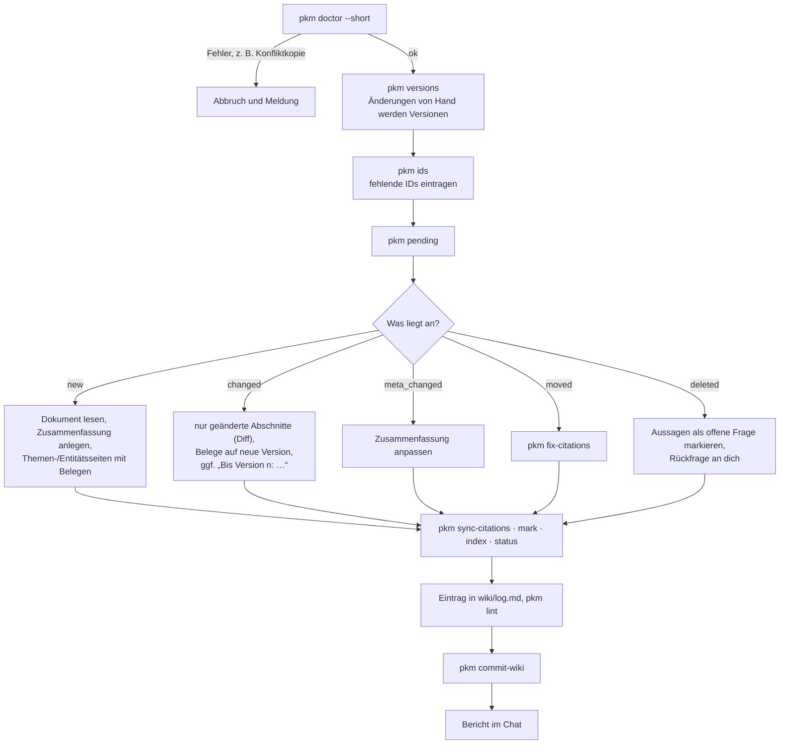
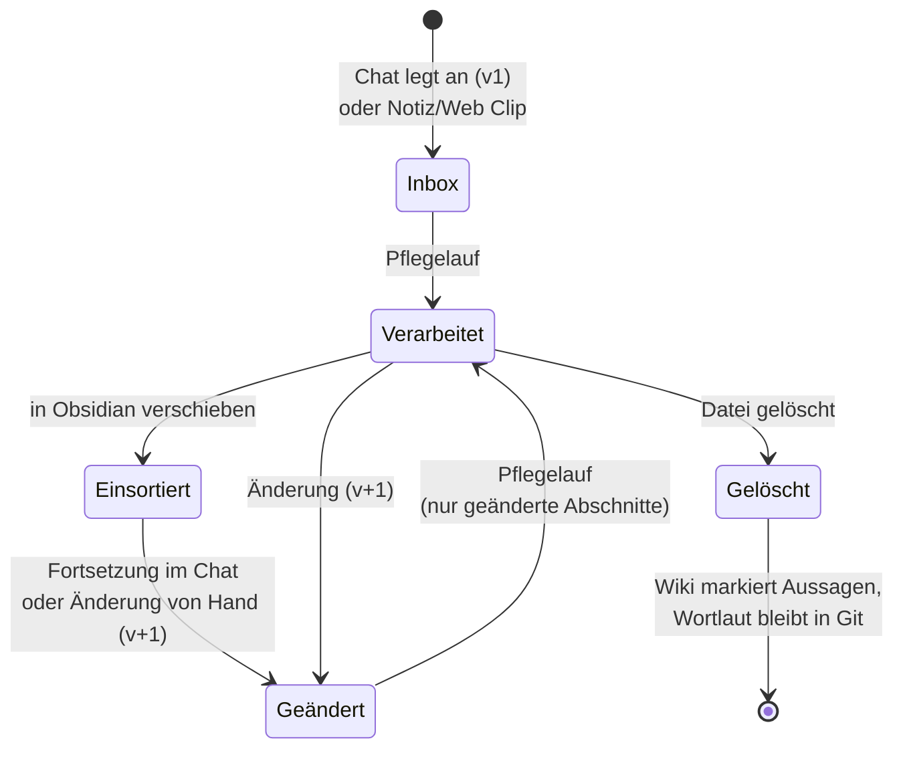

# PKM mit LLM-Wiki

Ein persönliches Wissensmanagement (PKM) aus reinem Markdown, das Claude für dich pflegt.

- Du sammelst Wissen in **Dokumenten**: von Hand in Obsidian, per Web Clipper oder direkt aus
  einem Claude-Chat („leg das ins PKM“).
- Ein **Pflege-Agent** baut daraus ein **kompiliertes Wiki** mit Zusammenfassungen, Themen- und
  Entitätsseiten. **Jede Aussage im Wiki ist mit einem Beleg** auf das Originaldokument versehen:
  Abschnitt, wörtliches Zitat, Version.
- Aus **jedem Chat** kannst du das Wiki abfragen, dir die Quellen nennen lassen und Dokumente
  fortschreiben. Jede Änderung wird eine **neue Version mit Git-Commit** und ist jederzeit
  umkehrbar.

Alles bleibt lesbares Markdown in einem normalen Ordner. Obsidian ist das Frontend, aber keine
Voraussetzung.

> **Installation:** siehe [docs/einrichtung.md](docs/einrichtung.md). Diese README beschreibt,
> was das System kann und wie du es danach benutzt.

---

## Inhalt

1. [Features](#features)
2. [So funktioniert es](#so-funktioniert-es)
3. [Der Vault](#der-vault)
4. [Benutzung im Alltag](#benutzung-im-alltag)
   - [In normalen Chats](#in-normalen-chats)
   - [In Obsidian](#in-obsidian)
   - [Im Pflegeprojekt](#im-pflegeprojekt)
5. [Versionen und Verlauf](#versionen-und-verlauf)
6. [Belege verstehen](#belege-verstehen)
7. [Regeln auf einen Blick](#regeln-auf-einen-blick)
8. [CLI-Referenz](#cli-referenz)
9. [Wenn etwas nicht stimmt](#wenn-etwas-nicht-stimmt)
10. [Projektstruktur und Entwicklung](#projektstruktur-und-entwicklung)

---

## Features

### Wissen ablegen – aus jedem Chat
- „Leg das ins PKM“: Claude verdichtet das Ergebnis einer Diskussion in die Abschnitte
  **Ergebnis · Entscheidungen · Offene Punkte · Kontext / Begründung** und zeigt dir einen
  **Entwurf**. Erst nach deiner Bestätigung wird gespeichert.
- Neue Dokumente landen in `documents/_inbox/` und bekommen eine feste **ID**
  (`d-20261031-2340-k7q2`) sowie `version: 1`.
- Vorher sucht Claude, ob es zum Thema schon ein Dokument gibt, und fragt, ob es fortgeschrieben
  werden soll.

### Dokumente fortschreiben statt anhängen
- „Führ die Diskussion zum Überlaufsensor weiter …“: Claude findet das Dokument, egal wohin du es
  inzwischen verschoben hast. Er **arbeitet die neuen Ergebnisse in die bestehenden Abschnitte
  ein** und zeigt dir **Vorher/Nachher je Abschnitt**. Das Dokument zeigt danach immer den
  aktuellen Stand, ohne Verlaufsballast.
- Kleine Änderungen (eine Textstelle, ein Punkt, Metadaten) gehen gezielt, ebenfalls nach
  Bestätigung.
- **Schutzmechanismen:**
  - Hast du die Datei inzwischen in Obsidian geändert, bricht die Änderung mit `conflict` ab.
  - Würde eine Neufassung viel Text oder ganze Abschnitte verlieren, fragt Claude ausdrücklich
    nach (`large_shortening`).

### Vollständiger Verlauf in Git
- Jede Änderung, ob aus dem Chat, von dir in Obsidian oder vom Agenten, ergibt **eine Version und
  einen Commit**. Der Commit enthält nur die betroffene Datei und eine Änderungsnotiz.
- „Was hat sich geändert?“ zeigt Verlauf und Diff. „Wie war das vorher?“ zeigt eine alte Version.
  „Mach das rückgängig“ holt eine alte Version als **neue** Version zurück, die Geschichte bleibt
  erhalten.
- Der Verlauf hängt an der ID, nicht am Pfad. Umbenennen und Verschieben sind also unkritisch.

### Ein Wiki mit Belegen
- Der Pflege-Agent erzeugt
  - **Zusammenfassungen** (eine je Dokument),
  - **Themenseiten** (Konzepte, Sachgebiete),
  - **Entitätsseiten** (Geräte, Software, Orte, Personen, Firmen),
  - **Synthesen** (Vergleiche, Entscheidungen, Übersichten),

  dazu einen **Index** mit Kurzfassungen und einen **Status** mit allem, was noch offen ist.
- **Jede Sachaussage endet mit einer Fußnote** auf das Original: Pfad, Abschnitt, wörtliches
  Zitat, ID, Version und Abschnitts-Hash. Wiki-Seiten untereinander gelten nicht als Beleg.
- Ändert sich ein Dokument, verarbeitet der Agent **nur die geänderten Abschnitte**. Bei
  geänderten Entscheidungen bleibt „Bis Version 1: …“ mit Beleg auf die alte Version stehen.

### Fragen und Quellen
- „Was weiß mein Wiki über …?“ beantwortet Claude aus dem Wiki, mit Verweisen auf die Seiten.
- „Woher stammt das?“ liefert zu jeder Aussage das Original, den Abschnitt, das Zitat, die
  belegte und die aktuelle Version, einen Status und auf Wunsch den Wortlaut aus dem Original.
  Ein Klick auf den `obsidian://`-Link öffnet das Dokument.
- Dokumente, die noch nicht ins Wiki eingearbeitet sind, werden als „noch nicht im Wiki“ erwähnt.

### Robust für Nextcloud, Mac und Windows
- Der Vault liegt in der Nextcloud. Gelesen und bearbeitet wird auf Mac **und** Windows.
- Git-Verzeichnis und Suchindex liegen **außerhalb** des synchronisierten Ordners, also kein
  `.git` im Vault.
- **Was das System unter Windows und bei Nextcloud abfängt:**
  - Zeilenenden von Windows (CRLF) und Umlaute in Dateinamen (NFC/NFD) gelten nicht als Änderung.
  - Dateinamen sind auf allen Systemen gültig.
  - Nextcloud-Konfliktkopien werden erkannt und nie verarbeitet.

### Sicher by Design
- Aus Chats ist das Wiki **nur lesbar**.
- Neue Dateien entstehen nur in `documents/_inbox/`, geändert werden nur bestehende
  Markdown-Dokumente.
- Löschen und Verschieben gibt es aus Chats nicht.
- Der MCP-Server ist **deterministisch**: keine LLM-Aufrufe, kein Netzwerk, keine Hintergrundprozesse.
- Keine Git-Operation schreibt Geschichte um.

### Prüfen und Pflegen
- `pkm lint` prüft:
  - kaputte Links und verwaiste Seiten,
  - Belege: Ziel fehlt oder verschoben, Zitat nicht im Original, Abschnitt geändert,
  - doppelte IDs und Versionsabweichungen,
  - Konfliktkopien und problematische Dateinamen.
- `pkm doctor` prüft die Umgebung (Git, Pfade, Obsidian-Einstellungen).

---

## So funktioniert es



| Komponente | Rolle |
|---|---|
| **pkm-mcp** | MCP-Server für Claude Desktop. Zwölf Tools zum Suchen, Lesen, Ablegen, Fortschreiben, für den Verlauf und die Belege. |
| **pkm** | Kommandozeile für die Pflege (IDs, Versionen, offene Dokumente, Belege, Index, Lint, Doctor). |
| **Skill `pkm-access`** | Sagt Claude in normalen Chats, wann und wie die Tools zu nutzen sind, z. B. „immer erst ein Entwurf“. |
| **Skill `pkm-wiki`** | Regeln und Abläufe für den Pflege-Agenten im Projekt „PKM-Pflege“. |
| **Git** | Versionsgeschichte jedes Dokuments und Nachvollziehbarkeit der Agentenarbeit. Nur lokal, gesichert per Time Machine. |

Der MCP-Server und die Pflege laufen **nur auf dem Mac**, solange dort Claude Desktop läuft.
Der Windows-Rechner nutzt den Vault nur über Obsidian.

---

## Der Vault

```
<Vault>/
├── documents/              ← deine Ablage, frei sortierbar
│   ├── _inbox/             ← neue Dokumente aus Chats und vom Web Clipper
│   ├── _attachments/       ← Bilder aus Web-Clips
│   └── …                   ← beliebige eigene Ordner, z. B. haus/, garten/
├── wiki/                   ← gehört dem Pflege-Agenten
│   ├── index.md            ← Katalog aller Seiten mit Kurzfassung (generiert)
│   ├── _status.md          ← Offenes, Einsortier-Vorschläge, Probleme, Rückfragen (generiert)
│   ├── log.md              ← Chronik aller Pflegeläufe
│   ├── topics/  entities/  summaries/  syntheses/
│   └── _lint/              ← Lint-Berichte
├── CLAUDE.md               ← Schema und Regeln (Änderungen nur mit deiner Zustimmung)
└── .pkm/                   ← state.json (Verarbeitungsstand), mcp.log (Protokoll)
```

| Bereich | Du (Obsidian) | Chat (pkm-mcp, auf deine Anweisung) | Pflege-Agent |
|---|---|---|---|
| `documents/_inbox/` | alles | neu anlegen, ändern | lesen, `id`/`version` setzen |
| `documents/**` | alles | ändern (nur Markdown) | lesen, `id`/`version` setzen |
| `wiki/` | lesen | nur lesen | lesen und schreiben |
| `CLAUDE.md` | lesen und schreiben | – | nur nach Zustimmung |

### Ein Dokument

```markdown
---
id: d-20261031-2340-k7q2
version: 3
title: Zisterne – Überlaufsensor
created: 2026-10-31T23:40:12+01:00
updated: 2026-11-02T19:05:00+01:00
source: claude-chat
context: "Chat: Füllstandsberechnung Tank 1"
topics: [zisterne, home-assistant]
related: ["[[documents/haus/zisterne]]"]
kind: note
---

## Ergebnis
## Entscheidungen
## Offene Punkte
## Kontext / Begründung
```

`id`, `version`, `created` und `updated` setzen ausschließlich Server und CLI. Alles andere
darfst du frei ändern. Eigene Notizen brauchen gar kein Frontmatter, ID und Version trägt der
Pflegelauf nach.

### Eine Wiki-Seite

```markdown
---
type: topic
title: Regenwasser-Ertrag
aliases: [Regenertrag]
sources:
  - "[[documents/haus/zisterne]]"
confidence: high
---

> **Kurzfassung:** Ein bis drei Sätze für Index und Suche.

## Inhalt
Die Dachfläche beträgt 92 m².[^b1]

## Widersprüche / offene Fragen
## Siehe auch
## Belege
[^b1]: [[documents/haus/zisterne#Dach]] · „Dachfläche laut Plan 92 m²“ · id:d-20261012-0915-x7mp · v:2 · sha:3f9a1c
```

---

## Benutzung im Alltag

### In normalen Chats

Der Skill `pkm-access` ist in allen Chats aktiv. Du sprichst ganz normal. Diese Formulierungen
lösen die passenden Abläufe aus:

| Du sagst | Claude macht |
|---|---|
| „Leg das ins PKM.“ / „Speicher das Ergebnis.“ | Sucht nach einem bestehenden Dokument, zeigt einen Entwurf und legt nach Bestätigung an. |
| „Führ die Diskussion zu … weiter.“ | Findet das Dokument und zeigt Vorher/Nachher je Abschnitt plus Änderungsnotiz. Nach Bestätigung entsteht eine neue Version. |
| „Ergänz im Dokument … bei den offenen Punkten …“ | Gezielte kleine Änderung, ebenfalls mit Vorher/Nachher. |
| „Was hat sich geändert?“ / „Wie war das vorher?“ | Verlauf mit Notizen und Diff bzw. eine frühere Version. |
| „Mach das rückgängig.“ | Holt die vorherige Version als neue Version zurück (nach Bestätigung). |
| „Was weiß mein Wiki über …?“ | Antwort aus dem Wiki mit Verweisen auf die Seiten. |
| „Woher stammt das?“ | Original, Abschnitt, Zitat, Versionen und Status je Aussage. |
| „Korrigier im Wiki: …“ | Legt ein **Korrektur-Dokument** an. Das Wiki selbst ändert nur der Pflege-Agent. |
| „Dokumentiere das als Fortsetzung.“ | Nur auf diese ausdrückliche Anweisung entsteht ein datierter Abschnitt `## Fortsetzung YYYY-MM-DD`. |

**Grundregel:** Vor jedem Schreibvorgang siehst du einen Entwurf und bestätigst ihn, ohne
Ausnahme. Auch „einfach direkt speichern“ führt zu einem kurzen Entwurf.



**Tipp:** Bleib nach dem Ablegen im selben Chat, dann kennt Claude die ID schon. In einem neuen
Chat reicht es, das Thema zu nennen.

### In Obsidian

- **Eigene Notizen** legst du einfach unter `documents/` an, mit oder ohne Frontmatter. Beim
  nächsten Pflegelauf bekommen sie ID und Version und werden ins Wiki eingearbeitet.
- **Einsortieren:** Verschiebe Dokumente aus `documents/_inbox/` in deine Ordner, am besten in
  Obsidian. Obsidian passt dabei alle Links und Belege im Wiki sofort an. Vorschläge, wohin ein
  verarbeitetes Dokument passt, stehen in `wiki/_status.md`.
- **Bearbeiten** ist jederzeit erlaubt. Deine Änderungen werden beim nächsten Pflegelauf (oder
  vor der nächsten Chat-Änderung derselben Datei) als eigene Version mit `PKM-Source: user`
  festgehalten. Mehrere Änderungen dazwischen ergeben eine Version.
- **Web Clipper** speichert nach `documents/_inbox/`, Bilder nach `documents/_attachments/`.
- **PDFs und Bilder** kannst du ebenfalls ablegen. Sie werden über ihren Inhalt erkannt. Eine neue
  Fassung eines PDFs gilt als neues Dokument.
- **Das Wiki** liest du in Obsidian, änderst es aber nicht. Fehler meldest du per
  Korrektur-Dokument aus einem Chat.
- **Überschriften:** Abschnitte sind Überschriften der Ebene 1 und 2. Bitte vermeiden:
  - doppelte Überschriften,
  - die Zeichen `# ^ [ ] |` in Überschriften,
  - Überschriften, die auf `#` plus Ziffern enden („Version 2“ statt „Version#2“).

  `pkm lint` weist darauf hin.
- **Nicht gleichzeitig** dasselbe Dokument auf Windows bearbeiten und per Chat ändern lassen.
  Entsteht doch eine Nextcloud-Konfliktkopie, führst du die Fassungen in Obsidian zusammen und
  löschst die Kopie.

### Im Pflegeprojekt

Im Claude-Projekt „PKM-Pflege“ ist der Vault-Ordner verbunden und der Skill `pkm-wiki` aktiv.
Pflegeläufe stößt du selbst an:

| Du sagst | Der Agent macht |
|---|---|
| „Verarbeite neue Dokumente.“ | Ingest: neue und geänderte Dokumente ins Wiki einarbeiten (siehe unten). |
| „Lint“ / „Prüf das Wiki.“ | Prüfbericht. Behebt Mechanisches selbst und schlägt Inhaltliches vor. |
| „Was steht im Wiki zu …?“ | Antwort aus Index und Seiten. Gute Antworten bietet er als Synthese-Seite an. |
| „Pass das Schema an: …“ | Schlägt Änderungen an `CLAUDE.md` vor und schreibt sie erst nach Zustimmung. |



**Was du nach einem Lauf anschauen solltest:**
- den **Bericht im Chat**: neue und geänderte Seiten, überholte Aussagen, Rückfragen,
- **`wiki/_status.md`**: noch Offenes, Einsortier-Vorschläge für die Inbox, Probleme
  (Konfliktkopien, doppelte IDs), Rückfragen,
- **`wiki/log.md`**: die Chronik aller Läufe.

Mehr als zehn neue Dokumente verarbeitet der Agent in Etappen. Eine tägliche **automatische**
Pflege ist vorbereitet, wird aber nur auf deine ausdrückliche Anweisung eingerichtet.

### Lebenszyklus eines Dokuments



---

## Versionen und Verlauf

| Änderung durch | Wann wird die Version erhöht? | `PKM-Source` |
|---|---|---|
| Chat (pkm-mcp) | sofort, je Änderung ein Commit | `chat` |
| Du in Obsidian (Mac oder Windows) | vor der nächsten Chat-Änderung dieser Datei oder beim nächsten Pflegelauf | `user` |
| Pflege-Agent | nur beim Nachtragen von IDs | `agent` |

- Reines Verschieben erhöht die Version nicht.
- Jeder Commit enthält genau ein Dokument. Agenten-Commits enthalten nur `wiki/` und
  `.pkm/state.json`. Ein `git revert` auf einen Agenten-Commit trifft also nur das Wiki.
- Der Verlauf liegt nur auf dem Mac unter `~/Library/Application Support/pkm/git` und wird über
  Time Machine gesichert.

Verlauf im Terminal ansehen:

```bash
pkm history id:d-20261031-2340-k7q2 --diff 1
```

```bash
pkm show id:d-20261031-2340-k7q2 --version 1 --section "Entscheidungen"
```

---

## Belege verstehen

```
[^b1]: [[documents/haus/zisterne#Dach]] · „Dachfläche laut Plan 92 m²“ · id:d-20261012-0915-x7mp · v:2 · sha:3f9a1c
        └─ Original und Abschnitt ──────┘   └─ wörtliches Zitat ──────┘   └─ feste ID ────────────┘  └Version┘ └Abschnitts-Hash┘
```

- PDFs: `[[documents/haus/datenblatt.pdf#page=2]] · „Nutzvolumen 6500 l“ · sha:c07d44`
- Bei doppelten Überschriften steht zusätzlich der genaue Abschnitt dabei: `§:Notizen#2`.

Status, den Claude bei „Woher stammt das?“ nennt:

| Status | Bedeutung |
|---|---|
| `ok` | Original gefunden, belegter Abschnitt unverändert |
| `moved` | Original liegt woanders; der Link wird beim nächsten Pflegelauf korrigiert |
| `newer_version` | Der Abschnitt hat sich seit der belegten Version geändert. Der Beleg stimmt für seine Version, die Aussage ist aber eventuell überholt |
| `missing` | Original nicht mehr vorhanden; der Wortlaut ist bei Markdown weiter über Git abrufbar |

---

## Regeln auf einen Blick

**Mach ruhig:**
- Dokumente in Obsidian anlegen, bearbeiten, umbenennen und verschieben (am besten in Obsidian)
- Chats bitten, Ergebnisse abzulegen oder fortzuschreiben
- nach Quellen fragen

**Lieber nicht:**
- `wiki/` von Hand bearbeiten (Korrekturen per Chat als Korrektur-Dokument)
- `id`, `version`, `created`, `updated` im Frontmatter ändern
- dasselbe Dokument gleichzeitig auf Windows und per Chat ändern
- `.git`, Suchindex oder Git-Verzeichnis in die Nextcloud legen
- Dateien kopieren, ohne die ID der Kopie zu ändern (Lint meldet doppelte IDs)

---

## CLI-Referenz

Die CLI benutzt vor allem der Pflege-Agent. Für dich sind `doctor`, `lint`, `history` und `show`
nützlich. Ausgabe ist immer JSON. Im Vault-Ordner findet die CLI den Vault selbst, sonst
`PKM_ROOT` setzen.

| Befehl | Zweck |
|---|---|
| `pkm init` | Struktur und Git-Verzeichnis anlegen (idempotent) |
| `pkm doctor [--short]` | Umgebung prüfen |
| `pkm lint [--report]` | Prüfbericht (mit `--report` nach `wiki/_lint/`) |
| `pkm versions` | Änderungen von Hand als Versionen committen |
| `pkm ids` | fehlende IDs eintragen |
| `pkm pending` | was noch ins Wiki muss |
| `pkm history <ziel> [--diff <von> [<bis>]]` | Verlauf und Diff |
| `pkm show <ziel> --version <n> [--section <abschnitt>]` | frühere Version lesen |
| `pkm restore <ziel> --version <n>` | frühere Version als neue Version zurückholen |
| `pkm sha <ziel> [--section <abschnitt>] [--full]` | Hashes (für Belege und Fehlersuche) |
| `pkm mark`, `index`, `status`, `fix-citations`, `sync-citations`, `commit-wiki` | Bausteine des Pflegelaufs |
| `pkm reindex` | Suchindex neu aufbauen |

Ziele können ein Pfad (`documents/haus/zisterne.md`), ein Wikilink (`[[zisterne]]`) oder eine ID
(`id:d-…`) sein.

---

## Wenn etwas nicht stimmt

| Situation | Was tun |
|---|---|
| Claude meldet `conflict` | Normal, wenn du die Datei gerade bearbeitet hast. Claude liest neu und baut die Änderung neu auf. |
| Claude meldet `large_shortening` | Claude fragt, ob wirklich gekürzt werden soll. Nur bestätigen, wenn das gewollt ist. |
| Pflegelauf bricht wegen Konfliktkopie ab | Fassungen in Obsidian zusammenführen, Kopie löschen, Lauf wiederholen. |
| Suche findet Neues nicht | `pkm reindex` |
| Tools fehlen in Claude Desktop oder `git_unavailable` | `pkm doctor` und [Einrichtung, Abschnitt 11](docs/einrichtung.md#11-fehlersuche) |

Protokoll aller Chat-Zugriffe: `<Vault>/.pkm/mcp.log`.

---

## Projektstruktur und Entwicklung

```
pkm-llm-wiki/
├── docs/
│   ├── spezifikation.md     ← vollständige Spezifikation
│   ├── umsetzungsplan.md    ← Phasen und Entscheidungen
│   ├── einrichtung.md       ← Installation und Einrichtung
│   └── abnahme.md           ← Abnahmeprotokoll
└── pkm-tools/               ← Python-Paket: pkm-mcp und pkm
    ├── src/pkm/
    ├── skills/              ← pkm-access, pkm-wiki
    └── tests/
```

Entwicklung und Tests: siehe [pkm-tools/README.md](pkm-tools/README.md). Die Tests laufen auf
Linux und macOS (GitHub Actions).

**Stand:** Phasen 0–6 umgesetzt. Die Abnahme auf dem Mac (Phase 7) steht aus. Die automatische
Pflege (Phase 8) folgt nur auf Anweisung.
