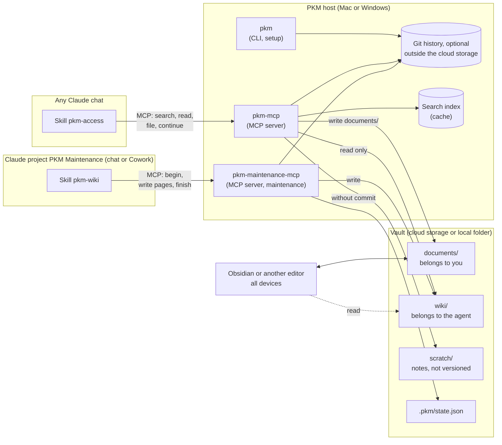
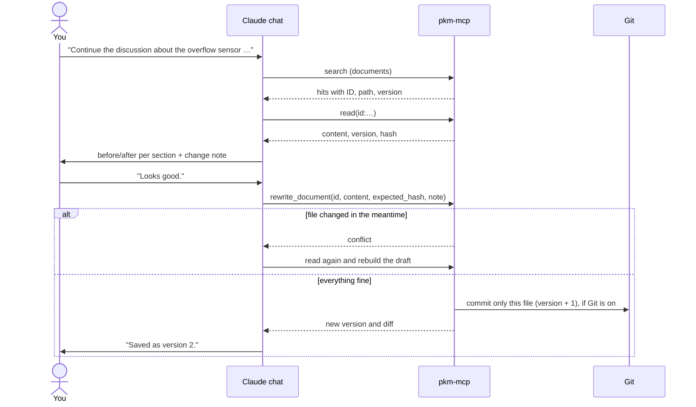
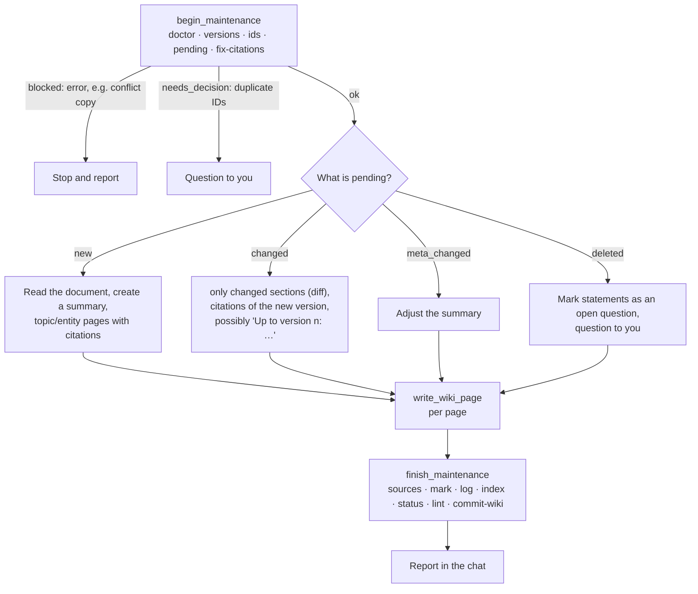
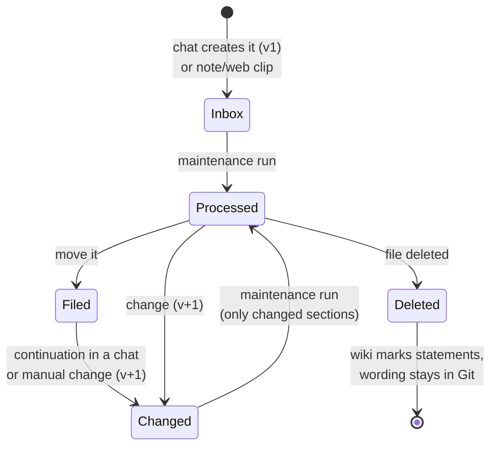
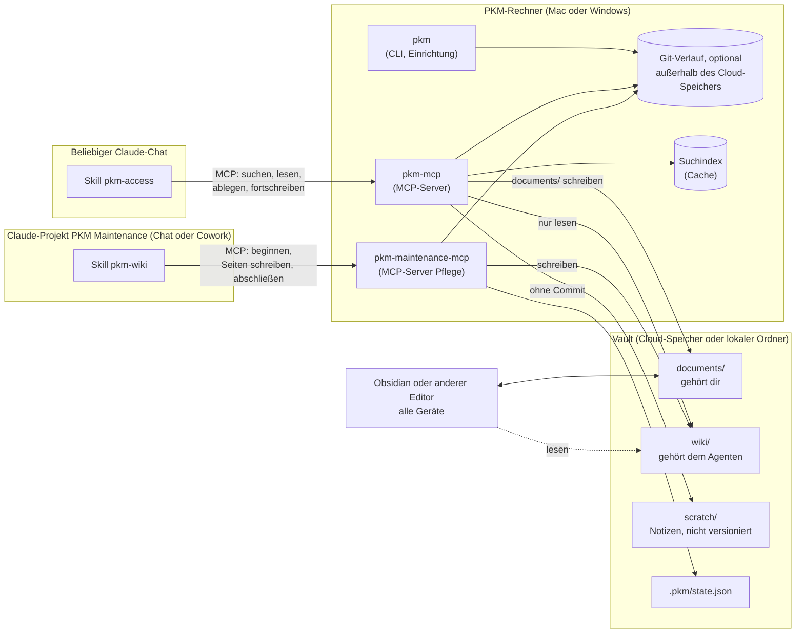
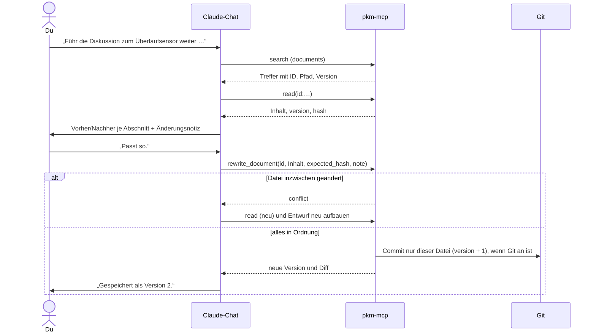
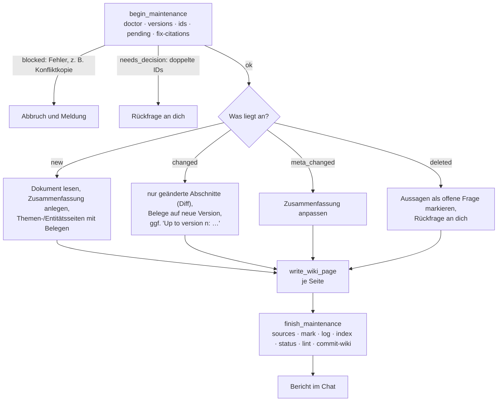
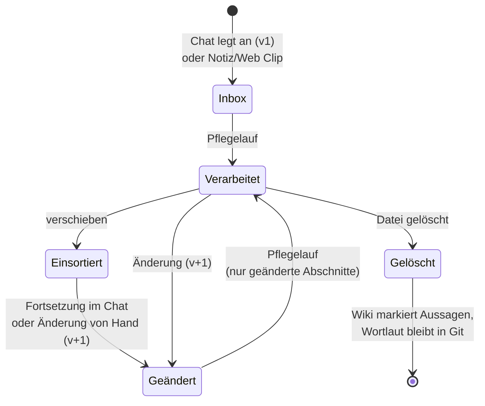

# PKM with LLM wiki · PKM mit LLM-Wiki

**[English](#english)** · **[Deutsch](#deutsch)**

---

## English

A personal knowledge management system (PKM) made of plain Markdown that Claude maintains for you.

- You collect knowledge in **documents**: by hand (e.g. in Obsidian), with the web clipper or
  directly from a Claude chat ("put this into the PKM").
- A **maintenance agent** compiles them into a **wiki** with summaries, topic and entity pages.
  **Every statement in the wiki carries a citation** of the original document: section, literal
  quote, version.
- From **any chat** you can query the wiki, ask for the sources and continue documents. With Git,
  every change becomes a **new version with a Git commit** and can be undone at any time. Git is
  optional: without Git the PKM runs without version control.
- For short-lived things such as **notes and todo lists** there is the area `scratch/`: writable
  from chats, but without versions and never in the wiki.

Everything stays readable Markdown in a normal folder. Optionally a **cloud storage service**
synchronizes it to your other devices (Nextcloud, OneDrive, Google Drive, Dropbox, iCloud Drive …);
a purely local folder works as well. Obsidian is the recommended front end, but not a requirement.

> **Installation:** one command, then `pkm setup` guides you through the setup.
>
> Mac: `curl -LsSf https://raw.githubusercontent.com/achim0x/pkm-llm-wiki/main/install.sh | sh`
>
> Windows (PowerShell): `powershell -ExecutionPolicy ByPass -c "irm https://raw.githubusercontent.com/achim0x/pkm-llm-wiki/main/install.ps1 | iex"`
>
> Details, including a manual installation, in [docs/installation.md](docs/installation.md); how it
> works inside in [docs/architecture.md](docs/architecture.md). This README describes what the system
> does and how you use it afterwards.

### Contents

1. [Features](#features)
2. [How it works](#how-it-works)
3. [The vault](#the-vault)
4. [Everyday use](#everyday-use)
   - [In normal chats](#in-normal-chats)
   - [In Obsidian or another editor](#in-obsidian-or-another-editor)
   - [In the maintenance project](#in-the-maintenance-project)
5. [Versions and history](#versions-and-history)
6. [Understanding citations](#understanding-citations)
7. [Rules at a glance](#rules-at-a-glance)
8. [CLI reference](#cli-reference)
9. [Cloud storage: pitfalls](#cloud-storage-pitfalls)
10. [When something is wrong](#when-something-is-wrong)
11. [Project structure and development](#project-structure-and-development)

### Features

#### Filing knowledge – from any chat
- "Put this into the PKM": Claude condenses the result of a discussion into the sections
  **Result · Decisions · Open points · Context / rationale** and shows you a **draft**. It saves only
  after you confirm.
- **Language:** during installation you choose whether documents created in chat and the wiki are
  mainly English or German (`pkm setup`, `PKM_LANGUAGE`). With German the sections are called
  **Ergebnis · Entscheidungen · Offene Punkte · Kontext / Begründung**, wiki pages use Kurzfassung,
  Inhalt, Widersprüche / offene Fragen, Siehe auch, Belege. Existing documents and pages keep their
  language.
- New documents land in `documents/_inbox/` and get a fixed **ID** (`d-20261031-2340-k7q2`) and
  `version: 1`.
- Before that, Claude searches for an existing document on the topic and asks whether it should be
  continued.

#### Continuing documents instead of appending
- "Continue the discussion about the overflow sensor …": Claude finds the document wherever you have
  moved it in the meantime. It **works the new results into the existing sections** and shows you
  **before/after per section**. The document always shows the current state, without history
  clutter.
- Small changes (a passage, an item, metadata) are targeted, also after confirmation.
- **Safeguards:**
  - If you changed the file in the meantime, the change stops with `conflict`.
  - If a rewrite would lose a lot of text or whole sections, Claude asks explicitly
    (`large_shortening`).

#### Complete history in Git (optional)

If Git is installed, `pkm setup` turns version control on. Without Git the PKM runs without it: IDs,
version numbers, maintenance runs and citations keep working; only history, diff and restoring are
missing. To add it later: install Git and run `pkm setup` again.

- Every change, whether from a chat, by you in an editor or by the agent, results in **one version
  and one commit**. The commit contains only the affected file and a change note.
- "What has changed?" shows history and diff. "What was it like before?" shows an old version.
  "Undo that" brings back an old version as a **new** version; the history is kept.
- The history is tied to the ID, not to the path, so renaming and moving are harmless.

#### A wiki with citations
- The maintenance agent creates
  - **summaries** (one per document),
  - **topic pages** (concepts, subject areas),
  - **entity pages** (devices, software, places, people, companies),
  - **syntheses** (comparisons, decisions, overviews),

  plus an **index** with summaries and a **status** page with everything that is still open.
- **Every factual statement ends with a footnote** to the original: path, section, literal quote,
  ID, version and section hash. Wiki pages do not count as citations of each other.
- When a document changes, the agent processes **only the changed sections**. For changed
  decisions, "Up to version 1: …" stays with a citation of the old version.

#### Notes and todo lists in `scratch/`
- "Make a quick note …", "put this on my todo list", "tick off …": Claude creates and changes notes
  in `scratch/`, also only after a draft.
- `scratch/` is **never taken into the wiki**, has **no versions and no commits** and is not in Git
  (with cloud storage, its file versions serve as a fallback). Lint, maintenance runs and citations
  ignore the area.
- If a note becomes permanently important, you move it to `documents/`. In the next maintenance run
  it is a normal document with ID and version 1.

#### Images in documents
- Claude draws diagrams, sketches and circuit diagrams as **SVG**; photos and screenshots stay
  **PNG**. Claude stores images when filing or changing documents, again only after a draft.
- **Small ones are embedded, large ones become files:** up to 24 KB the image is in the document
  itself (data URI), larger images go to a folder `<document name>_img/` next to the document,
  linked relative to it (`./<document name>_img/…`), so document and images stay together when you
  pass them on. The same image in one document is stored only once. In `scratch/` images are always
  embedded.
- **Names and image folders:** in a maintenance run the agent checks names in `_inbox/` (lower case,
  hyphens, `<name>_YYYY-MM-DD.md`) and where image files lie, and proposes renames and moves
  (`rename_document`, `move_images`); it changes nothing without your confirmation. When you file a
  document from `_inbox/`, its `_img/` folder has to move along – the agent proposes that, too.
- **Attachments in any folder:** an image file that a document links to belongs to that document,
  wherever it lies (also a folder of exported images next to a converted document). Maintenance
  processes it with the document, not as a source of its own.
- **Large embedded images** (e.g. from a web article) can be stored as files after your confirmation
  (`fix_images` with `extract`); the bytes stay the same. The size limit `PKM_MAX_KB` only counts the
  text, not embedded images; if a document should still be larger, Claude asks you and writes it after
  your confirmation.
- **Photos from the chat:** Claude cannot pass on uploaded images byte for byte. You put the file
  (PNG or JPEG) into the folder `pkm_img_import/` in the vault, also from your phone via the app of
  your cloud storage; Claude takes it from there. For JPEG the server removes GPS and camera data.
- Images belong to their document and are versioned with it. Claude views them with `read_image`;
  Base64 never ends up in the chat. In the wiki, images are described in words and cited with
  `[img:<name>]`.
- SVG is sanitized before saving (no scripts, no external references), PNG is checked.
- **Nonconforming data URIs** (e.g. SVG in reference style with unencoded characters, which Obsidian
  does not display) are detected however they get into the PKM. Claude shows findings and a fix
  proposal; **fixes happen only after your confirmation** (`fix_images`, `pkm fix-images`), never
  automatically.

#### Questions and sources
- "What does my wiki know about …?" Claude answers from the wiki, with references to the pages.
- "Where does this come from?" returns for every statement the original, the section, the quote,
  the cited and the current version, a status and, on request, the wording from the original. A
  click on the `obsidian://` link opens the document.
- Documents that are not yet in the wiki are mentioned as "not yet in the wiki".

#### Robust with cloud storage, Mac and Windows
- The vault can live in a cloud storage of your choice (or in a local folder). It can be read and
  edited on Mac **and** Windows; MCP servers, maintenance and Git run on exactly one PKM host (Mac
  or Windows).
- The Git directory and the search index live **outside** the synchronized folder, so there is no
  `.git` in the vault. `pkm doctor` warns if they are in a cloud folder after all.
- **What the system handles on Windows and with cloud storage:**
  - Windows line endings (CRLF) and umlauts in file names (NFC/NFD) do not count as changes.
  - File names are valid on all systems.
  - **Conflict copies of all known services** are detected automatically and never processed: by
    name (Nextcloud, ownCloud, Dropbox, Google Drive, Syncthing, pCloud, Box) and as a copy next to
    the original with the same document ID (OneDrive, iCloud Drive, Google Drive).
  - Files that only exist online as placeholders are reported by `pkm doctor`.

What to watch out for per service is in [Cloud storage: pitfalls](#cloud-storage-pitfalls).

#### Secure by design
- From chats the wiki is **read-only**.
- New files are only created in `documents/_inbox/`; only existing Markdown documents are changed.
- There is no deleting or moving from chats.
- The MCP servers are **deterministic**: no LLM calls, no network, no background processes.
- No Git operation rewrites history.

#### Checking and maintaining
- `pkm lint` checks:
  - broken links and orphaned pages,
  - citations: target missing or moved, quote not in the original, section changed,
  - duplicate IDs and version mismatches,
  - conflict copies and problematic file names.
- `pkm doctor` checks the environment (Git, paths, cloud folders, Obsidian settings).

### How it works



| Component | Role |
|---|---|
| **pkm-mcp** | MCP server for Claude Desktop. 15 tools for searching, reading, filing, continuing, for images, the history and the citations. |
| **pkm-maintenance-mcp** | MCP server for wiki maintenance from Claude Desktop or Cowork: `begin_maintenance`, `write_wiki_page`, `set_document_metadata`, `rename_document`, `move_images`, `fix_images`, `finish_maintenance` plus the reading tools. Writes to `wiki/` and `.pkm/state.json`; on documents only IDs and – after your confirmation – `title`, `context`, `tags`, `kind`, `short_citation`. Enable it only in maintenance conversations. |
| **pkm** | Command line for setup (`pkm setup`), checks and troubleshooting (the same maintenance commands, one by one). |
| **Skill `pkm-access`** | Tells Claude in normal chats when and how to use the tools, e.g. "always a draft first". |
| **Skill `pkm-wiki`** | Rules and flows for the maintenance agent in the project "PKM Maintenance". |
| **Git (optional)** | Version history of every document and traceability of the agent's work. Only local on the PKM host, part of the backup. |

The MCP servers and the maintenance run on **one** PKM host, a Mac or a Windows PC, as long as
Claude Desktop is running there. Other devices use the vault only through an editor.

### The vault

```
<Vault>/
├── documents/              ← your filing, freely sortable
│   ├── _inbox/             ← new documents from chats and from the web clipper
│   ├── house/
│   │   ├── cistern.md
│   │   └── cistern_img/    ← images of cistern.md (larger than 24 KB)
│   └── …                   ← any folders of your own, e.g. garden/
├── scratch/                ← notes and todo lists: not in Git, never in the wiki
├── pkm_img_import/         ← hand over images from the chat: not in Git, never in the wiki
├── wiki/                   ← belongs to the maintenance agent
│   ├── index.md                 ← catalog of all pages with summary (generated)
│   ├── _status.md               ← open items, filing proposals, problems, questions (generated)
│   ├── log.md                   ← chronicle of all maintenance runs
│   ├── topics/  entities/  summaries/  syntheses/
│   └── _lint/              ← lint reports
├── CLAUDE.md               ← schema and rules (changes only with your consent)
└── .pkm/                   ← state.json (processing state), mcp.log (log)
```

| Area | You (editor) | Chat (pkm-mcp, on your instruction) | Maintenance agent |
|---|---|---|---|
| `documents/_inbox/` | everything | create, change | read, set `id`/`version` |
| `documents/**` | everything | change (Markdown only) | read, set `id`/`version` |
| `scratch/**` | everything | create, change (Markdown only), without version and commit | ignored |
| `wiki/` | read | read only | read and write |
| `CLAUDE.md` | read and write | – | only with consent |

#### A document

```markdown
---
title: Cistern – overflow sensor
date_markdown: 2026-10-31T23:40:12
toolchain_markdown: Claude Opus 5.5 (pkm-mcp)
id: d-20261031-2340-k7q2
version: 3
date_updated: 2026-11-02T19:05:00
context: "Chat: fill level calculation tank 1"
tags: [cistern, home-assistant]
related: ["[[documents/house/cistern]]"]
kind: note
---

## Result
## Decisions
## Open points
## Context / rationale
```

The field names follow the schema of the digitized standards (`title`, `short_citation`,
`date_document`, `status_markdown`, `date_markdown`, `toolchain_markdown`), extended by `id`,
`version`, `date_updated`, `context`, `tags`, `related` and `kind`.

- `id`, `version`, `date_markdown` and `date_updated` are set only by the server and the CLI.
  `status_markdown` (standards only) is taken over unchanged. You may change everything else freely.
- Date fields have the format `YYYY-MM-DDTHH:MM:SS` in local time without time zone, as Obsidian's
  "Date & time" expects.
- `kind` is `note` (default), `standard` (standards), `regulation` (laws, ordinances) or
  `correction` (correction request).
- Values containing `: ` (such as titles of standards) are in double quotes, otherwise the YAML is
  invalid. `pkm lint` reports this, `pkm fix-frontmatter` fixes it on your instruction.
- Your own notes need no frontmatter at all; the maintenance run adds ID and version. Already
  converted standards only get `id` and `version` appended.

A standard can also be addressed by its short citation, e.g. "What does EN 61000-4-6:2014 say
about …?": `short_citation` works as a target everywhere.

#### A wiki page

```markdown
---
type: topic
title: Rainwater yield
aliases: [Rain yield]
sources:
  - "[[documents/house/cistern]]"
confidence: high
---

> **Summary:** One to three sentences for index and search.

## Content
The roof area is 92 m².[^b1]

## Contradictions / open questions
## See also
## Citations
[^b1]: [[documents/house/cistern#Roof]] · "Roof area according to plan 92 m²" · id:d-20261012-0915-x7mp · v:2 · sha:3f9a1c
```

Generated wiki content (pages, index, status, log, reports) is English. Existing pages with the
German sections "Inhalt" and "Widersprüche / offene Fragen" are still recognized.

### Everyday use

#### In normal chats

The skill `pkm-access` is active in all chats. You talk normally; these phrases trigger the matching
flows:

| You say | Claude does |
|---|---|
| "Put this into the PKM." / "Save the result." | Searches for an existing document, shows a draft and creates it after confirmation. |
| "Continue the discussion about …" | Finds the document and shows before/after per section plus a change note. After confirmation a new version is created. |
| "Add … to the open points in the document …" | Targeted small change, also with before/after. |
| "What has changed?" / "What was it like before?" | History with notes and diff, or an earlier version (needs Git). |
| "Undo that." | Brings back the previous version as a new version (after confirmation; needs Git). |
| "What does my wiki know about …?" | Answer from the wiki with references to the pages. |
| "Where does this come from?" | Original, section, quote, versions and status per statement. |
| "Make a quick note …" / "Put … on my todo list" | Note in `scratch/` (after a draft), without version and commit, never in the wiki. |
| "Tick off …" / "What is on my list?" | Changes or reads the list in `scratch/` (search with `scope: "scratch"`). |
| "Draw this as a diagram into the document." | SVG diagram as a draft, after confirmation in the document (`images` or `add_image`). |
| "Include the photo `photo.png` from the import folder." | Takes the file from `pkm_img_import/` in the vault (`import_path`). |
| "Correct in the wiki: …" | Creates a **correction document**. Only the maintenance agent changes the wiki itself. |
| "Document this as a continuation." | Only on this explicit instruction a dated section `## Continuation YYYY-MM-DD` is created. |

**Basic rule:** before every write you see a draft and confirm it, without exception. Even "just save
it directly" leads to a short draft.



**Tip:** stay in the same chat after filing, then Claude already knows the ID. In a new chat it is
enough to name the topic.

#### In Obsidian or another editor

- **Your own notes** you simply create under `documents/`, with or without frontmatter. In the next
  maintenance run they get ID and version and are worked into the wiki.
- **Filing:** move documents from `documents/_inbox/` into your folders, preferably in Obsidian.
  Obsidian immediately adjusts all links and citations in the wiki; without Obsidian the next
  maintenance run fixes the citations and wiki links. Proposals where a processed document fits are
  in `wiki/_status.md`.
- **Editing** is allowed at any time. With Git your changes are recorded as a version of their own
  with `PKM-Source: user` in the next maintenance run (or before the next chat change of the same
  file); several changes in between result in one version.
- The **web clipper** saves to `documents/_inbox/`; images pasted in Obsidian land next to the note
  (the agent proposes moving them into `<note name>_img/`).
- **PDFs and images** can be filed as well. They are recognized by their content. A new version of
  a PDF counts as a new document.
- **Notes and todo lists** go into `scratch/` if they should not go into the wiki. You tidy up
  there yourself. Moving a note to `documents/` turns it into a document; the other way round it
  acts like a deletion for the wiki.
- **The wiki** you read, but do not change. Report errors with a correction document from a chat.
- **Headings:** sections are headings of level 1 and 2. Please avoid:
  - duplicate headings,
  - the characters `# ^ [ ] |` in headings,
  - headings that end in `#` plus digits ("Version 2" instead of "Version#2").

  `pkm lint` points this out.
- **Not at the same time:** do not edit the same document on another device and have a chat change
  it. If a conflict copy appears anyway, merge the versions and delete the copy.

#### In the maintenance project

In the Claude project "PKM Maintenance" (chat or Cowork) the skill `pkm-wiki` is active and the server
`pkm-maintenance` is enabled in the conversation. The agent needs no shell. You start maintenance runs
yourself:

| You say | The agent does |
|---|---|
| "Process new documents." | Ingest: works new and changed documents into the wiki (see below). |
| "Lint" / "Check the wiki." | Lint report. Fixes mechanical issues itself and proposes content changes. |
| "What does the wiki say about …?" | Answer from index and pages. It offers good answers as a synthesis page. |
| "Adjust the schema: …" | Proposes changes to `CLAUDE.md` and writes them only after consent. |



**What to look at after a run:**
- the **report in the chat**: new and changed pages, outdated statements, questions,
- **`wiki/_status.md`**: open items, filing proposals for the inbox, problems (conflict copies,
  duplicate IDs), questions,
- **`wiki/log.md`**: the chronicle of all runs.

The agent processes more than ten new documents in stages. A daily **automatic** maintenance is
prepared, but set up only on your explicit instruction.

#### Life cycle of a document



### Versions and history

Applies with Git (version control on):

| Change by | When is the version raised? | `PKM-Source` |
|---|---|---|
| Chat (pkm-mcp) | immediately, one commit per change | `chat` |
| You in an editor (Mac or Windows) | before the next chat change of this file or in the next maintenance run | `user` |
| Maintenance agent | only when adding IDs or confirmed metadata | `agent` |

- A pure move does not raise the version.
- Every commit contains exactly one document. Agent commits contain only `wiki/` and
  `.pkm/state.json`, so a `git revert` of an agent commit only affects the wiki.
- The history lives only on the PKM host (Mac: `~/Library/Application Support/pkm/git`, Windows:
  `%APPDATA%\pkm\git`) and belongs in the backup.
- Without Git, chat changes still raise the version number, but there is no commit and no history.

View the history in the terminal:

```bash
pkm history id:d-20261031-2340-k7q2 --diff 1
```

```bash
pkm show id:d-20261031-2340-k7q2 --version 1 --section "Decisions"
```

### Understanding citations

```
[^b1]: [[documents/house/cistern#Roof]] · "Roof area according to plan 92 m²" · id:d-20261012-0915-x7mp · v:2 · sha:3f9a1c
        └─ original and section ───────┘   └─ literal quote ──────────────────┘   └─ fixed ID ────────────┘  └version┘ └section hash┘
```

- PDFs: `[[documents/house/datasheet.pdf#page=2]] · "Usable volume 6500 l" · sha:c07d44`
- For duplicate headings the exact section is added: `§:Notes#2`.

Status that Claude names for "Where does this come from?":

| Status | Meaning |
|---|---|
| `ok` | Original found, cited section unchanged |
| `moved` | The original is somewhere else; the link is fixed in the next maintenance run |
| `newer_version` | The section has changed since the cited version. The citation is right for its version, but the statement may be outdated |
| `missing` | Original no longer exists; with Git the wording of Markdown documents is still available |

### Rules at a glance

**Go ahead:**
- create, edit, rename and move documents (preferably in Obsidian)
- ask chats to file or continue results
- ask for sources

**Better not:**
- edit `wiki/` by hand (corrections via a chat as a correction document)
- change `id`, `version`, `date_markdown`, `date_updated` or `status_markdown` in the frontmatter
- change the same document on another device and via a chat at the same time
- put `.git`, the search index or the Git directory into the cloud storage
- copy files without changing the ID of the copy (lint reports duplicate IDs)

### CLI reference

The maintenance agent does not need the CLI; it uses `pkm-maintenance-mcp`, which bundles the same
commands. Useful for you are `setup`, `init`, `doctor`, `lint`, `history`, `show`, `fix-frontmatter`
and `fix-images`. The output is JSON (except for `pkm setup`). The CLI knows the vault from the
configuration file written by `pkm setup`; otherwise it finds it from inside the vault folder.

| Command | Purpose |
|---|---|
| `pkm --version` | show the installed version of pkm-tools (also reported by `pkm setup` and `pkm doctor`) |
| `pkm setup` | guided setup: existing configuration, vault, Git check, language, `CLAUDE.md` update, Claude Desktop, skills (repeatable) |
| `pkm init` | create structure, Obsidian settings and (with Git) the Git directory (idempotent) |
| `pkm doctor [--short]` | check the environment |
| `pkm lint [--report]` | lint report (with `--report` to `wiki/_lint/`) |
| `pkm versions` | commit manual changes as versions (with Git) |
| `pkm ids` | add missing IDs |
| `pkm pending` | what still has to go into the wiki |
| `pkm history <target> [--diff <from> [<to>]]` | history and diff (with Git) |
| `pkm show <target> --version <n> [--section <section>]` | read an earlier version (with Git) |
| `pkm restore <target> --version <n>` | restore an earlier version as a new version (with Git) |
| `pkm sha <target> [--section <section>] [--full]` | hashes (for citations and troubleshooting) |
| `pkm fix-frontmatter [<target>…] [--all]` | repair frontmatter (quotes, `short citation` → `short_citation`); without a target only list. Only on your instruction |
| `pkm fix-images [<target>…] [--all] [--apply] [--alt <name>=<text>]` | fix image data URIs per 4.9; without a target only list, without `--apply` only a proposal with diff. Only on your instruction |
| `pkm mark`, `index`, `status`, `fix-citations`, `sync-citations`, `commit-wiki` | building blocks of the maintenance run |
| `pkm reindex` | rebuild the search index |

Targets can be a path (`documents/house/cistern.md`), a wikilink (`[[cistern]]`), an ID (`id:d-…`)
or a short citation (`EN 61000-4-6:2014`). All commands except `pkm reindex` ignore `scratch/`.

### Cloud storage: pitfalls

Cloud storage is optional. The PKM works with every service that synchronizes a **normal local
folder**. For all of them:

1. **Keep the vault completely local.** The maintenance run reads every file. Files that exist only
   as placeholders ("online only") trigger downloads or are missing without a connection.
   `pkm doctor` reports such files (`vault_online_only`).
2. **Never put the Git directory or the search index into the cloud folder.** The default
   (`~/Library/Application Support/pkm` or `%APPDATA%\pkm`) is outside; `pkm doctor` checks this for
   all known services.
3. **Merge conflict copies.** They are detected and not processed; you merge the versions and
   delete the copy.
4. **One PKM host per vault**, whatever the service.

| Service | What to watch | A conflict copy is called e.g. |
|---|---|---|
| **Nextcloud / ownCloud** | Turn "virtual files" off for the vault folder. File versions serve as a fallback for `scratch/`. | `note (conflicted copy 2026-11-04 120000).md` |
| **OneDrive** | "Files On-Demand": set the vault folder to **"Always keep on this device"**. On Windows "Documents" is often moved into OneDrive automatically – never put the Git directory there. On the Mac the folder is under `~/Library/CloudStorage/OneDrive-…`. | `note-COMPUTERNAME.md` (detected if the copy has the same ID) |
| **Google Drive** | In the settings choose **"Mirror files"** instead of "Stream" (or make the folder available offline). On the Mac `~/Library/CloudStorage/GoogleDrive-…/My Drive`. Google Drive keeps old file versions only for a limited time. | `note [Conflict].md`, `note (1).md`, `Copy of note.md` |
| **Dropbox** | Do not set the folder to "Online only". | `note (Name's conflicted copy 2026-11-04).md` |
| **iCloud Drive** | "Optimize Mac Storage" can offload files: keep the vault folder downloaded in Finder ("Keep Downloaded"). Works well only on Apple devices; on Windows limited via the iCloud app. | `note 2.md` (detected if the copy has the same ID) |
| **Syncthing** | No placeholders; synchronizes only while both devices are online at the same time. | `note.sync-conflict-20261104-120000-ABCDEFG.md` |

On the Mac, OneDrive, Google Drive and iCloud manage their folders through macOS
(`~/Library/CloudStorage/…`). Obsidian and the PKM work with them, but access is a bit slower than
with a normal folder. The vault path then points there.

### When something is wrong

| Situation | What to do |
|---|---|
| Claude reports `conflict` | Normal if you just edited the file. Claude reads again and rebuilds the change. |
| Claude reports `large_shortening` | Claude asks whether it really should shorten. Confirm only if you want that. |
| Claude reports `not_versioned` | Version control is off (no Git) or the file is in `scratch/`. To turn it on: install Git and run `pkm setup` again. |
| A maintenance run stops because of a conflict copy | Merge the versions, delete the copy, repeat the run. |
| `pkm doctor` reports `vault_online_only` | Keep the vault folder local in the cloud service (see [pitfalls](#cloud-storage-pitfalls)). |
| The search does not find new things | `pkm reindex` |
| Tools are missing in Claude Desktop or `git_unavailable` | Run `pkm setup` again, `pkm doctor` and [installation, troubleshooting](docs/installation.md#10-troubleshooting) |

Log of all chat accesses: `<Vault>/.pkm/mcp.log`.

### Project structure and development

```
pkm-llm-wiki/
├── docs/
│   ├── specification.md         ← full specification (German)
│   ├── implementation-plan.md   ← phases and decisions (German)
│   ├── installation.md          ← installation and setup (English)
│   ├── installation.de.md       ← installation and setup (German)
│   ├── architecture.md          ← architecture, installation flow, pkm-tools internals (English)
│   ├── acceptance.md            ← acceptance protocol (German)
│   └── release-notes.md         ← release notes (English)
├── pkm-tools/                   ← Python package: pkm-mcp, pkm-maintenance-mcp and pkm
│   ├── src/pkm/
│   │   └── skills/              ← pkm-access, pkm-wiki
│   └── tests/
└── install.sh, install.ps1      ← installers (Mac/Linux, Windows)
```

Development and tests: see [pkm-tools/README.md](pkm-tools/README.md). To run the PKM directly from
a local clone of the repository (editable install, with a test vault), see
[installation, appendix B](docs/installation.md#appendix-b-development-installation). The tests run on Linux,
macOS and Windows (GitHub Actions).

**Status:** phases 0–6 and the follow-up work are implemented. The acceptance run (phase 7) is
pending. Automatic maintenance (phase 8) follows only on instruction.

### License

Copyright (c) Achim0x. This project is licensed under the
[GNU General Public License v3.0](LICENSE) or any later version.

---

## Deutsch

Ein persönliches Wissensmanagement (PKM) aus reinem Markdown, das Claude für dich pflegt.

- Du sammelst Wissen in **Dokumenten**: von Hand (z. B. in Obsidian), per Web Clipper oder direkt aus
  einem Claude-Chat („leg das ins PKM“).
- Ein **Pflege-Agent** baut daraus ein **kompiliertes Wiki** mit Zusammenfassungen, Themen- und
  Entitätsseiten. **Jede Aussage im Wiki ist mit einem Beleg** auf das Originaldokument versehen:
  Abschnitt, wörtliches Zitat, Version.
- Aus **jedem Chat** kannst du das Wiki abfragen, dir die Quellen nennen lassen und Dokumente
  fortschreiben. Mit Git wird jede Änderung eine **neue Version mit Git-Commit** und ist jederzeit
  umkehrbar. Git ist optional: ohne Git läuft das PKM ohne Versionsverwaltung.
- Für Kurzlebiges wie **Notizen und Todo-Listen** gibt es den Bereich `scratch/`: aus Chats
  beschreibbar, aber ohne Versionen und nie im Wiki.

Alles bleibt lesbares Markdown in einem normalen Ordner. Optional synchronisiert ein
**Cloud-Speicher** ihn auf deine anderen Geräte (Nextcloud, OneDrive, Google Drive, Dropbox, iCloud
Drive …); ein rein lokaler Ordner geht auch. Obsidian ist das empfohlene Frontend, aber keine
Voraussetzung.

> **Installation:** ein Befehl, danach führt `pkm setup` durch die Einrichtung.
>
> Mac: `curl -LsSf https://raw.githubusercontent.com/achim0x/pkm-llm-wiki/main/install.sh | sh`
>
> Windows (PowerShell): `powershell -ExecutionPolicy ByPass -c "irm https://raw.githubusercontent.com/achim0x/pkm-llm-wiki/main/install.ps1 | iex"`
>
> Einzelheiten, auch zur manuellen Installation, in [docs/installation.de.md](docs/installation.de.md); wie
> es intern funktioniert, in [docs/architecture.md](docs/architecture.md) (englisch). Diese README
> beschreibt, was das System kann und wie du es danach benutzt.

### Inhalt

1. [Funktionen](#funktionen)
2. [So funktioniert es](#so-funktioniert-es)
3. [Der Vault](#der-vault)
4. [Benutzung im Alltag](#benutzung-im-alltag)
   - [In normalen Chats](#in-normalen-chats)
   - [In Obsidian oder einem anderen Editor](#in-obsidian-oder-einem-anderen-editor)
   - [Im Pflegeprojekt](#im-pflegeprojekt)
5. [Versionen und Verlauf](#versionen-und-verlauf)
6. [Belege verstehen](#belege-verstehen)
7. [Regeln auf einen Blick](#regeln-auf-einen-blick)
8. [CLI-Referenz](#cli-referenz)
9. [Cloud-Speicher: Stolpersteine](#cloud-speicher-stolpersteine)
10. [Wenn etwas nicht stimmt](#wenn-etwas-nicht-stimmt)
11. [Projektstruktur und Entwicklung](#projektstruktur-und-entwicklung)

### Funktionen

#### Wissen ablegen – aus jedem Chat
- „Leg das ins PKM“: Claude verdichtet das Ergebnis einer Diskussion in die Abschnitte
  **Ergebnis · Entscheidungen · Offene Punkte · Kontext / Begründung** und zeigt dir einen
  **Entwurf**. Erst nach deiner Bestätigung wird gespeichert.
- **Sprache:** Bei der Installation legst du fest, ob im Chat erzeugte Dokumente und das Wiki
  hauptsächlich englisch oder deutsch sind (`pkm setup`, `PKM_LANGUAGE`). Mit Englisch heißen die
  Abschnitte **Result · Decisions · Open points · Context / rationale**, Wiki-Seiten nutzen
  Summary, Content, Contradictions / open questions, See also, Citations. Bestehende Dokumente und
  Seiten behalten ihre Sprache.
- Neue Dokumente landen in `documents/_inbox/` und bekommen eine feste **ID**
  (`d-20261031-2340-k7q2`) sowie `version: 1`.
- Vorher sucht Claude, ob es zum Thema schon ein Dokument gibt, und fragt, ob es fortgeschrieben
  werden soll.

#### Dokumente fortschreiben statt anhängen
- „Führ die Diskussion zum Überlaufsensor weiter …“: Claude findet das Dokument, egal wohin du es
  inzwischen verschoben hast. Er **arbeitet die neuen Ergebnisse in die bestehenden Abschnitte
  ein** und zeigt dir **Vorher/Nachher je Abschnitt**. Das Dokument zeigt danach immer den
  aktuellen Stand, ohne Verlaufsballast.
- Kleine Änderungen (eine Textstelle, ein Punkt, Metadaten) gehen gezielt, ebenfalls nach
  Bestätigung.
- **Schutzmechanismen:**
  - Hast du die Datei inzwischen in Obsidian geändert, bricht die Änderung mit `conflict` ab.
  - Würde eine Neufassung viel Text oder ganze Abschnitte verlieren, fragt Claude ausdrücklich
    nach (`large_shortening`).

#### Vollständiger Verlauf in Git (optional)

Ist Git installiert, schaltet `pkm setup` die Versionsverwaltung ein. Ohne Git läuft das PKM ohne
sie: IDs, Versionsnummern, Pflegelauf und Belege funktionieren weiter, nur Verlauf, Diff und
Wiederherstellen fehlen. Nachrüsten: Git installieren und `pkm setup` erneut ausführen.

- Jede Änderung, ob aus dem Chat, von dir im Editor oder vom Agenten, ergibt **eine Version und
  einen Commit**. Der Commit enthält nur die betroffene Datei und eine Änderungsnotiz.
- „Was hat sich geändert?“ zeigt Verlauf und Diff. „Wie war das vorher?“ zeigt eine alte Version.
  „Mach das rückgängig“ holt eine alte Version als **neue** Version zurück, die Geschichte bleibt
  erhalten.
- Der Verlauf hängt an der ID, nicht am Pfad. Umbenennen und Verschieben sind also unkritisch.

#### Ein Wiki mit Belegen
- Der Pflege-Agent erzeugt
  - **Zusammenfassungen** (eine je Dokument),
  - **Themenseiten** (Konzepte, Sachgebiete),
  - **Entitätsseiten** (Geräte, Software, Orte, Personen, Firmen),
  - **Synthesen** (Vergleiche, Entscheidungen, Übersichten),

  dazu einen **Index** mit Kurzfassungen und einen **Status** mit allem, was noch offen ist.
- **Jede Sachaussage endet mit einer Fußnote** auf das Original: Pfad, Abschnitt, wörtliches
  Zitat, ID, Version und Abschnitts-Hash. Wiki-Seiten untereinander gelten nicht als Beleg.
- Ändert sich ein Dokument, verarbeitet der Agent **nur die geänderten Abschnitte**. Bei
  geänderten Entscheidungen bleibt „Up to version 1: …“ mit Beleg auf die alte Version stehen.

#### Notizen und Todo-Listen in `scratch/`
- „Notier mir kurz …“, „setz das auf meine Todo-Liste“, „hak … ab“: Claude legt Notizen in
  `scratch/` an und ändert sie, ebenfalls erst nach einem Entwurf.
- `scratch/` wird **nie ins Wiki übernommen**, hat **keine Versionen und keine Commits** und steht
  nicht in Git (mit Cloud-Speicher dienen dessen Dateiversionen als Rückfallebene). Lint,
  Pflegelauf und Belege ignorieren den Bereich.
- Wird eine Notiz dauerhaft wichtig, verschiebst du sie nach `documents/`. Beim nächsten
  Pflegelauf ist sie ein ganz normales Dokument mit ID und Version 1.

#### Bilder in Dokumenten
- Diagramme, Skizzen und Schaltpläne zeichnet Claude als **SVG**, Fotos und Screenshots bleiben
  **PNG**. Bilder legt Claude beim Ablegen oder Ändern mit ab, wieder erst nach einem Entwurf.
- **Klein wird eingebettet, groß wird Datei:** bis 24 KB steht das Bild direkt im Dokument
  (Data-URI), größere Bilder landen in einem Ordner `<Dokumentname>_img/` neben dem Dokument,
  relativ verlinkt (`./<Dokumentname>_img/…`), damit Dokument und Bilder beim Weitergeben
  zusammenbleiben. Gleiche Bilder in einem Dokument werden nur einmal abgelegt. In `scratch/` wird
  immer eingebettet.
- **Namen und Bildordner:** Beim Pflegelauf prüft der Agent Namen in `_inbox/` (klein,
  Bindestriche, `<name>_YYYY-MM-DD.md`) und wo Bilddateien liegen, und schlägt Umbenennen und Umzüge
  vor (`rename_document`, `move_images`); ohne deine Bestätigung ändert er nichts. Sortierst du ein
  Dokument aus `_inbox/` ein, muss sein `_img/`-Ordner mit – auch das schlägt der Agent vor.
- **Anhänge in jedem Ordner:** Eine Bilddatei, die ein Dokument verlinkt, gehört zu diesem Dokument,
  egal wo sie liegt (auch ein Ordner exportierter Bilder neben einem umgewandelten Dokument). Die
  Pflege verarbeitet sie mit dem Dokument, nicht als eigene Quelle.
- **Große eingebettete Bilder** (z. B. aus einem Web-Artikel) lassen sich nach deiner Bestätigung als
  Datei ablegen (`fix_images` mit `extract`); die Bytes bleiben gleich. Die Größengrenze
  `PKM_MAX_KB` zählt nur den Text, nicht die eingebetteten Bilder; soll ein Dokument trotzdem größer
  werden, fragt Claude nach und schreibt es nach deiner Bestätigung.
- **Fotos aus dem Chat:** Claude kann hochgeladene Bilder nicht byte-genau weitergeben. Du legst die
  Datei (PNG oder JPEG) in den Ordner `pkm_img_import/` im Vault, auch vom Smartphone über die App deines Cloud-Speichers;
  Claude übernimmt sie von dort. Bei JPEG entfernt der Server GPS- und Kameradaten.
- Bilder gehören zu ihrem Dokument und werden mit ihm versioniert. Claude sieht sie sich mit
  `read_image` an; Base64 landet nie im Chat. Im Wiki werden Bilder in Worten übernommen und mit
  `[img:<name>]` belegt.
- SVG wird vor dem Speichern bereinigt (keine Skripte, keine externen Verweise), PNG geprüft.
- **Abweichende Data-URIs** (z. B. SVG im Referenzstil mit nicht kodierten Zeichen, das Obsidian nicht
  anzeigt) werden erkannt, egal wie sie ins PKM kommen. Claude zeigt Befunde und Korrekturvorschlag;
  **korrigiert wird nur nach deiner Bestätigung** (`fix_images`, `pkm fix-images`), nie automatisch.

#### Fragen und Quellen
- „Was weiß mein Wiki über …?“ beantwortet Claude aus dem Wiki, mit Verweisen auf die Seiten.
- „Woher stammt das?“ liefert zu jeder Aussage das Original, den Abschnitt, das Zitat, die
  belegte und die aktuelle Version, einen Status und auf Wunsch den Wortlaut aus dem Original.
  Ein Klick auf den `obsidian://`-Link öffnet das Dokument.
- Dokumente, die noch nicht ins Wiki eingearbeitet sind, werden als „noch nicht im Wiki“ erwähnt.

#### Robust für Cloud-Speicher, Mac und Windows
- Der Vault liegt in einem Cloud-Speicher deiner Wahl (oder in einem lokalen Ordner). Gelesen und bearbeitet wird auf Mac **und**
  Windows; MCP-Server, Pflege und Git laufen auf genau einem PKM-Rechner (Mac oder Windows).
- Git-Verzeichnis und Suchindex liegen **außerhalb** des synchronisierten Ordners, also kein
  `.git` im Vault. `pkm doctor` warnt, wenn sie doch in einem Cloud-Ordner liegen.
- **Was das System unter Windows und bei Cloud-Speichern abfängt:**
  - Zeilenenden von Windows (CRLF) und Umlaute in Dateinamen (NFC/NFD) gelten nicht als Änderung.
  - Dateinamen sind auf allen Systemen gültig.
  - **Konfliktkopien aller bekannten Dienste** werden automatisch erkannt und nie verarbeitet:
    am Namen (Nextcloud, ownCloud, Dropbox, Google Drive, Syncthing, pCloud, Box) und als Kopie
    neben dem Original mit derselben Dokument-ID (OneDrive, iCloud Drive, Google Drive).
  - Dateien, die nur online als Platzhalter vorliegen, meldet `pkm doctor`.

Was je Dienst zu beachten ist, steht unter [Cloud-Speicher: Stolpersteine](#cloud-speicher-stolpersteine).

#### Sicher by Design
- Aus Chats ist das Wiki **nur lesbar**.
- Neue Dateien entstehen nur in `documents/_inbox/`, geändert werden nur bestehende
  Markdown-Dokumente.
- Löschen und Verschieben gibt es aus Chats nicht.
- Die MCP-Server sind **deterministisch**: keine LLM-Aufrufe, kein Netzwerk, keine Hintergrundprozesse.
- Keine Git-Operation schreibt Geschichte um.

#### Prüfen und Pflegen
- `pkm lint` prüft:
  - kaputte Links und verwaiste Seiten,
  - Belege: Ziel fehlt oder verschoben, Zitat nicht im Original, Abschnitt geändert,
  - doppelte IDs und Versionsabweichungen,
  - Konfliktkopien und problematische Dateinamen.
- `pkm doctor` prüft die Umgebung (Git, Pfade, Cloud-Ordner, Obsidian-Einstellungen).


### So funktioniert es



| Komponente | Rolle |
|---|---|
| **pkm-mcp** | MCP-Server für Claude Desktop. 15 Tools zum Suchen, Lesen, Ablegen, Fortschreiben, für Bilder, den Verlauf und die Belege. |
| **pkm-maintenance-mcp** | MCP-Server für die Wiki-Pflege aus Claude Desktop bzw. Cowork: `begin_maintenance`, `write_wiki_page`, `set_document_metadata`, `rename_document`, `move_images`, `fix_images`, `finish_maintenance` plus die lesenden Tools. Schreibt in `wiki/` und `.pkm/state.json`, an Dokumenten nur IDs und – nach deiner Bestätigung – `title`, `context`, `tags`, `kind`, `short_citation`; nur in Pflege-Unterhaltungen einschalten. |
| **pkm** | Kommandozeile für Einrichtung (`pkm setup`), Prüfung und Fehlersuche (dieselben Pflege-Befehle, einzeln). |
| **Skill `pkm-access`** | Sagt Claude in normalen Chats, wann und wie die Tools zu nutzen sind, z. B. „immer erst ein Entwurf“. |
| **Skill `pkm-wiki`** | Regeln und Abläufe für den Pflege-Agenten im Projekt „PKM Maintenance“. |
| **Git (optional)** | Versionsgeschichte jedes Dokuments und Nachvollziehbarkeit der Agentenarbeit. Nur lokal auf dem PKM-Rechner, Teil der Datensicherung. |

Der MCP-Server und die Pflege laufen auf **einem** PKM-Rechner, einem Mac oder einem Windows-PC,
solange dort Claude Desktop läuft. Weitere Geräte nutzen den Vault nur über einen Editor.


### Der Vault

```
<Vault>/
├── documents/              ← deine Ablage, frei sortierbar
│   ├── _inbox/             ← neue Dokumente aus Chats und vom Web Clipper
│   ├── haus/
│   │   ├── zisterne.md
│   │   └── zisterne_img/   ← Bilder von zisterne.md (größer als 24 KB)
│   └── …                   ← beliebige eigene Ordner, z. B. garten/
├── scratch/                ← Notizen und Todo-Listen: nicht in Git, nie im Wiki
├── pkm_img_import/         ← Bilder aus dem Chat übergeben: nicht in Git, nie im Wiki
├── wiki/                   ← gehört dem Pflege-Agenten
│   ├── index.md                 ← Katalog aller Seiten mit Kurzfassung (generiert)
│   ├── _status.md               ← Offenes, Einsortier-Vorschläge, Probleme, Rückfragen (generiert)
│   ├── log.md                   ← Chronik aller Pflegeläufe
│   ├── topics/  entities/  summaries/  syntheses/
│   └── _lint/              ← Lint-Berichte
├── CLAUDE.md               ← Schema und Regeln (Änderungen nur mit deiner Zustimmung)
└── .pkm/                   ← state.json (Verarbeitungsstand), mcp.log (Protokoll)
```

| Bereich | Du (Editor) | Chat (pkm-mcp, auf deine Anweisung) | Pflege-Agent |
|---|---|---|---|
| `documents/_inbox/` | alles | neu anlegen, ändern | lesen, `id`/`version` setzen |
| `documents/**` | alles | ändern (nur Markdown) | lesen, `id`/`version` setzen |
| `scratch/**` | alles | neu anlegen, ändern (nur Markdown), ohne Version und Commit | ignoriert |
| `wiki/` | lesen | nur lesen | lesen und schreiben |
| `CLAUDE.md` | lesen und schreiben | – | nur nach Zustimmung |

#### Ein Dokument

```markdown
---
title: Cistern – overflow sensor
date_markdown: 2026-10-31T23:40:12
toolchain_markdown: Claude Opus 5.5 (pkm-mcp)
id: d-20261031-2340-k7q2
version: 3
date_updated: 2026-11-02T19:05:00
context: "Chat: fill level calculation tank 1"
tags: [cistern, home-assistant]
related: ["[[documents/house/cistern]]"]
kind: note
---

## Result
## Decisions
## Open points
## Context / rationale
```

Die Feldnamen folgen dem Schema der digitalisierten Normen (`title`, `short_citation`,
`date_document`, `status_markdown`, `date_markdown`, `toolchain_markdown`), ergänzt um `id`,
`version`, `date_updated`, `context`, `tags`, `related` und `kind`.

- `id`, `version`, `date_markdown` und `date_updated` setzen ausschließlich Server und CLI.
  `status_markdown` (nur bei Normen) übernimmt das System unverändert. Alles andere darfst du frei
  ändern.
- Datumsfelder haben das Format `YYYY-MM-DDTHH:MM:SS` in Ortszeit ohne Zeitzone, wie Obsidian
  „Datum & Uhrzeit“ es erwartet.
- `kind` ist `note` (Standard), `standard` (Normen), `regulation` (Gesetze, Verordnungen) oder
  `correction` (Korrekturwunsch).
- Werte mit `: ` (etwa Normtitel) stehen in doppelten Anführungszeichen, sonst ist das YAML
  ungültig. `pkm lint` meldet das, `pkm fix-frontmatter` behebt es auf deine Anweisung.
- Eigene Notizen brauchen gar kein Frontmatter, ID und Version trägt der Pflegelauf nach. Bereits
  umgewandelte Normen bekommen dabei nur `id` und `version` angehängt.

Eine Norm lässt sich auch über ihre Kurzbezeichnung ansprechen, z. B. „Was sagt EN 61000-4-6:2014
zu …?“: `short_citation` ist überall als Ziel verwendbar.

#### Eine Wiki-Seite

```markdown
---
type: topic
title: Rainwater yield
aliases: [Rain yield]
sources:
  - "[[documents/house/cistern]]"
confidence: high
---

> **Summary:** One to three sentences for index and search.

## Content
The roof area is 92 m².[^b1]

## Contradictions / open questions
## See also
## Citations
[^b1]: [[documents/house/cistern#Roof]] · "Roof area according to plan 92 m²" · id:d-20261012-0915-x7mp · v:2 · sha:3f9a1c
```

Inhalte, die das PKM erzeugt (Wiki-Seiten, Index, Status, Log, Berichte), sind englisch. Bestehende
Seiten mit den deutschen Abschnitten „Inhalt“ und „Widersprüche / offene Fragen“ werden weiter
erkannt.


### Benutzung im Alltag

#### In normalen Chats

Der Skill `pkm-access` ist in allen Chats aktiv. Du sprichst ganz normal. Diese Formulierungen
lösen die passenden Abläufe aus:

| Du sagst | Claude macht |
|---|---|
| „Leg das ins PKM.“ / „Speicher das Ergebnis.“ | Sucht nach einem bestehenden Dokument, zeigt einen Entwurf und legt nach Bestätigung an. |
| „Führ die Diskussion zu … weiter.“ | Findet das Dokument und zeigt Vorher/Nachher je Abschnitt plus Änderungsnotiz. Nach Bestätigung entsteht eine neue Version. |
| „Ergänz im Dokument … bei den offenen Punkten …“ | Gezielte kleine Änderung, ebenfalls mit Vorher/Nachher. |
| „Was hat sich geändert?“ / „Wie war das vorher?“ | Verlauf mit Notizen und Diff bzw. eine frühere Version (braucht Git). |
| „Mach das rückgängig.“ | Holt die vorherige Version als neue Version zurück (nach Bestätigung; braucht Git). |
| „Was weiß mein Wiki über …?“ | Antwort aus dem Wiki mit Verweisen auf die Seiten. |
| „Woher stammt das?“ | Original, Abschnitt, Zitat, Versionen und Status je Aussage. |
| „Notier mir kurz …“ / „Setz … auf meine Todo-Liste“ | Notiz in `scratch/` (nach Entwurf), ohne Version und Commit, nie im Wiki. |
| „Hak … ab“ / „Was steht auf meiner Liste?“ | Ändert bzw. liest die Liste in `scratch/` (Suche mit `scope: "scratch"`). |
| „Zeichne das als Diagramm ins Dokument.“ | SVG-Diagramm als Entwurf, nach Bestätigung im Dokument (`images` bzw. `add_image`). |
| „Nimm das Foto `foto.png` aus dem Importordner mit auf.“ | Übernimmt die Datei aus `pkm_img_import/` im Vault (`import_path`). |
| „Korrigier im Wiki: …“ | Legt ein **Korrektur-Dokument** an. Das Wiki selbst ändert nur der Pflege-Agent. |
| „Dokumentiere das als Fortsetzung.“ | Nur auf diese ausdrückliche Anweisung entsteht ein datierter Abschnitt `## Continuation YYYY-MM-DD`. |

**Grundregel:** Vor jedem Schreibvorgang siehst du einen Entwurf und bestätigst ihn, ohne
Ausnahme. Auch „einfach direkt speichern“ führt zu einem kurzen Entwurf.



**Tipp:** Bleib nach dem Ablegen im selben Chat, dann kennt Claude die ID schon. In einem neuen
Chat reicht es, das Thema zu nennen.

#### In Obsidian oder einem anderen Editor

- **Eigene Notizen** legst du einfach unter `documents/` an, mit oder ohne Frontmatter. Beim
  nächsten Pflegelauf bekommen sie ID und Version und werden ins Wiki eingearbeitet.
- **Einsortieren:** Verschiebe Dokumente aus `documents/_inbox/` in deine Ordner, am besten in
  Obsidian. Obsidian passt dabei alle Links und Belege im Wiki sofort an; ohne Obsidian korrigiert
  der nächste Pflegelauf Belege und Wiki-Links. Vorschläge, wohin ein
  verarbeitetes Dokument passt, stehen in `wiki/_status.md`.
- **Bearbeiten** ist jederzeit erlaubt. Mit Git werden deine Änderungen beim nächsten Pflegelauf
  (oder vor der nächsten Chat-Änderung derselben Datei) als eigene Version mit `PKM-Source: user`
  festgehalten. Mehrere Änderungen dazwischen ergeben eine Version.
- **Web Clipper** speichert nach `documents/_inbox/`; in Obsidian eingefügte Bilder landen neben
  der Notiz (der Agent schlägt den Umzug nach `<Notizname>_img/` vor).
- **PDFs und Bilder** kannst du ebenfalls ablegen. Sie werden über ihren Inhalt erkannt. Eine neue
  Fassung eines PDFs gilt als neues Dokument.
- **Notizen und Todo-Listen** legst du in `scratch/` ab, wenn sie nicht ins Wiki sollen. Aufräumen
  (löschen, verschieben) machst du dort selbst. Verschieben nach `documents/` macht
  aus einer Notiz ein Dokument; umgekehrt wirkt es für das Wiki wie Löschen.
- **Das Wiki** liest du, änderst es aber nicht. Fehler meldest du per
  Korrektur-Dokument aus einem Chat.
- **Überschriften:** Abschnitte sind Überschriften der Ebene 1 und 2. Bitte vermeiden:
  - doppelte Überschriften,
  - die Zeichen `# ^ [ ] |` in Überschriften,
  - Überschriften, die auf `#` plus Ziffern enden („Version 2“ statt „Version#2“).

  `pkm lint` weist darauf hin.
- **Nicht gleichzeitig** dasselbe Dokument auf einem anderen Gerät bearbeiten und per Chat ändern
  lassen. Entsteht doch eine Konfliktkopie, führst du die Fassungen zusammen und löschst die Kopie.

#### Im Pflegeprojekt

Im Claude-Projekt „PKM Maintenance“ (Chat oder Cowork) ist der Skill `pkm-wiki` aktiv und in der
Unterhaltung der Server `pkm-maintenance` eingeschaltet. Eine Shell braucht der Agent nicht.
Pflegeläufe stößt du selbst an:

| Du sagst | Der Agent macht |
|---|---|
| „Verarbeite neue Dokumente.“ | Ingest: neue und geänderte Dokumente ins Wiki einarbeiten (siehe unten). |
| „Lint“ / „Prüf das Wiki.“ | Prüfbericht. Behebt Mechanisches selbst und schlägt Inhaltliches vor. |
| „Was steht im Wiki zu …?“ | Antwort aus Index und Seiten. Gute Antworten bietet er als Synthese-Seite an. |
| „Pass das Schema an: …“ | Schlägt Änderungen an `CLAUDE.md` vor und schreibt sie erst nach Zustimmung. |



**Was du nach einem Lauf anschauen solltest:**
- den **Bericht im Chat**: neue und geänderte Seiten, überholte Aussagen, Rückfragen,
- **`wiki/_status.md`**: noch Offenes, Einsortier-Vorschläge für die Inbox, Probleme
  (Konfliktkopien, doppelte IDs), Rückfragen,
- **`wiki/log.md`**: die Chronik aller Läufe.

Mehr als zehn neue Dokumente verarbeitet der Agent in Etappen. Eine tägliche **automatische**
Pflege ist vorbereitet, wird aber nur auf deine ausdrückliche Anweisung eingerichtet.

#### Lebenszyklus eines Dokuments




### Versionen und Verlauf

Gilt mit Git (Versionsverwaltung an):

| Änderung durch | Wann wird die Version erhöht? | `PKM-Source` |
|---|---|---|
| Chat (pkm-mcp) | sofort, je Änderung ein Commit | `chat` |
| Du im Editor (Mac oder Windows) | vor der nächsten Chat-Änderung dieser Datei oder beim nächsten Pflegelauf | `user` |
| Pflege-Agent | nur beim Nachtragen von IDs oder bestätigten Metadaten | `agent` |

- Reines Verschieben erhöht die Version nicht.
- Jeder Commit enthält genau ein Dokument. Agenten-Commits enthalten nur `wiki/` und
  `.pkm/state.json`. Ein `git revert` auf einen Agenten-Commit trifft also nur das Wiki.
- Der Verlauf liegt nur auf dem PKM-Rechner (Mac: `~/Library/Application Support/pkm/git`,
  Windows: `%APPDATA%\pkm\git`) und gehört in die Datensicherung.
- Ohne Git erhöhen Chat-Änderungen weiter die Versionsnummer, es gibt aber keinen Commit und keinen
  Verlauf.

Verlauf im Terminal ansehen:

```bash
pkm history id:d-20261031-2340-k7q2 --diff 1
```

```bash
pkm show id:d-20261031-2340-k7q2 --version 1 --section "Decisions"
```


### Belege verstehen

```
[^b1]: [[documents/house/cistern#Roof]] · "Roof area according to plan 92 m²" · id:d-20261012-0915-x7mp · v:2 · sha:3f9a1c
        └─ Original und Abschnitt ─────┘   └─ wörtliches Zitat ───────────────────┘   └─ feste ID ────────────┘  └Version┘ └Abschnitts-Hash┘
```

- PDFs: `[[documents/house/datasheet.pdf#page=2]] · "Usable volume 6500 l" · sha:c07d44`
- Bei doppelten Überschriften steht zusätzlich der genaue Abschnitt dabei: `§:Notes#2`.

Status, den Claude bei „Woher stammt das?“ nennt:

| Status | Bedeutung |
|---|---|
| `ok` | Original gefunden, belegter Abschnitt unverändert |
| `moved` | Original liegt woanders; der Link wird beim nächsten Pflegelauf korrigiert |
| `newer_version` | Der Abschnitt hat sich seit der belegten Version geändert. Der Beleg stimmt für seine Version, die Aussage ist aber eventuell überholt |
| `missing` | Original nicht mehr vorhanden; mit Git ist der Wortlaut bei Markdown weiter abrufbar |


### Regeln auf einen Blick

**Mach ruhig:**
- Dokumente anlegen, bearbeiten, umbenennen und verschieben (am besten in Obsidian)
- Chats bitten, Ergebnisse abzulegen oder fortzuschreiben
- nach Quellen fragen

**Lieber nicht:**
- `wiki/` von Hand bearbeiten (Korrekturen per Chat als Korrektur-Dokument)
- `id`, `version`, `date_markdown`, `date_updated` oder `status_markdown` im Frontmatter ändern
- dasselbe Dokument gleichzeitig auf einem anderen Gerät und per Chat ändern
- `.git`, Suchindex oder Git-Verzeichnis in den Cloud-Speicher legen
- Dateien kopieren, ohne die ID der Kopie zu ändern (Lint meldet doppelte IDs)


### CLI-Referenz

Der Pflege-Agent braucht die CLI nicht; er nutzt `pkm-maintenance-mcp`, das dieselben Befehle bündelt.
Für dich sind `setup`, `init`, `doctor`, `lint`, `history`, `show`, `fix-frontmatter` und `fix-images` nützlich.
Ausgabe ist JSON (außer bei `pkm setup`). Den Vault kennt die CLI aus der Konfigurationsdatei von
`pkm setup`; sonst findet sie ihn im Vault-Ordner selbst.

| Befehl | Zweck |
|---|---|
| `pkm --version` | installierte Version von pkm-tools anzeigen (melden auch `pkm setup` und `pkm doctor`) |
| `pkm setup` | geführte Einrichtung: vorhandene Konfiguration, Vault, Git-Prüfung, Sprache, `CLAUDE.md` aktualisieren, Claude Desktop, Skills (wiederholbar) |
| `pkm init` | Struktur, Obsidian-Einstellungen und (mit Git) Git-Verzeichnis anlegen (idempotent) |
| `pkm doctor [--short]` | Umgebung prüfen |
| `pkm lint [--report]` | Prüfbericht (mit `--report` nach `wiki/_lint/`) |
| `pkm versions` | Änderungen von Hand als Versionen committen (mit Git) |
| `pkm ids` | fehlende IDs eintragen |
| `pkm pending` | was noch ins Wiki muss |
| `pkm history <ziel> [--diff <von> [<bis>]]` | Verlauf und Diff (mit Git) |
| `pkm show <ziel> --version <n> [--section <abschnitt>]` | frühere Version lesen (mit Git) |
| `pkm restore <ziel> --version <n>` | frühere Version als neue Version zurückholen (mit Git) |
| `pkm sha <ziel> [--section <abschnitt>] [--full]` | Hashes (für Belege und Fehlersuche) |
| `pkm fix-frontmatter [<ziel>…] [--all]` | Frontmatter reparieren (Anführungszeichen, `short citation` → `short_citation`); ohne Ziel nur auflisten. Nur auf deine Anweisung |
| `pkm fix-images [<ziel>…] [--all] [--apply] [--alt <name>=<text>]` | Bild-Data-URIs nach 4.9 korrigieren; ohne Ziel nur auflisten, ohne `--apply` nur Vorschlag mit Diff. Nur auf deine Anweisung |
| `pkm mark`, `index`, `status`, `fix-citations`, `sync-citations`, `commit-wiki` | Bausteine des Pflegelaufs |
| `pkm reindex` | Suchindex neu aufbauen |

Ziele können ein Pfad (`documents/haus/zisterne.md`), ein Wikilink (`[[zisterne]]`), eine ID
(`id:d-…`) oder eine Kurzbezeichnung (`EN 61000-4-6:2014`) sein. Alle Befehle außer `pkm reindex` ignorieren `scratch/`.


### Cloud-Speicher: Stolpersteine

Der Cloud-Speicher ist optional. Das PKM funktioniert mit jedem Dienst, der einen **normalen
lokalen Ordner** synchronisiert. Für alle gilt:

1. **Vault vollständig lokal halten.** Der Pflegelauf liest jede Datei. Liegen Dateien nur als
   Platzhalter vor („nur online“), lösen sie Downloads aus oder fehlen ohne Verbindung.
   `pkm doctor` meldet solche Dateien (`vault_online_only`).
2. **Git-Verzeichnis und Suchindex nie in den Cloud-Ordner.** Der Standard
   (`~/Library/Application Support/pkm` bzw. `%APPDATA%\pkm`) liegt außerhalb; `pkm doctor` prüft
   das für alle bekannten Dienste.
3. **Konfliktkopien zusammenführen.** Sie werden erkannt und nicht verarbeitet; du führst die
   Fassungen in Obsidian zusammen und löschst die Kopie.
4. **Ein PKM-Rechner je Vault**, egal welcher Dienst.

| Dienst | Worauf achten | Konfliktkopie heißt z. B. |
|---|---|---|
| **Nextcloud / ownCloud** | „Virtuelle Dateien“ für den Vault-Ordner ausschalten. Dateiversionen dienen als Rückfallebene für `scratch/`. | `notiz (conflicted copy 2026-11-04 120000).md` |
| **OneDrive** | „Dateien bei Bedarf“: Vault-Ordner auf **„Immer auf diesem Gerät behalten“**. Unter Windows wird „Dokumente“ oft automatisch in OneDrive verschoben – das Git-Verzeichnis nie dorthin legen. Auf dem Mac liegt der Ordner unter `~/Library/CloudStorage/OneDrive-…`. | `notiz-RECHNERNAME.md` (erkannt, wenn die Kopie dieselbe ID trägt) |
| **Google Drive** | In den Einstellungen **„Dateien spiegeln“** statt „Streamen“ (oder den Ordner offline verfügbar machen). Auf dem Mac `~/Library/CloudStorage/GoogleDrive-…/My Drive`. Alte Dateiversionen hebt Google Drive nur begrenzt auf. | `notiz [Conflict].md`, `notiz (1).md`, `Kopie von notiz.md` |
| **Dropbox** | Ordner nicht auf „Nur online“ stellen. | `notiz (Name's conflicted copy 2026-11-04).md` |
| **iCloud Drive** | „Mac-Speicher optimieren“ kann Dateien auslagern: den Vault-Ordner im Finder dauerhaft geladen halten (Kontextmenü „Heruntergeladen behalten“ bzw. „Keep Downloaded“). Nur auf Apple-Geräten gut nutzbar; unter Windows über die iCloud-App eingeschränkt. | `notiz 2.md` (erkannt, wenn die Kopie dieselbe ID trägt) |
| **Syncthing** | Keine Platzhalter; synchronisiert nur, wenn beide Geräte gleichzeitig online sind. | `notiz.sync-conflict-20261104-120000-ABCDEFG.md` |

Auf dem Mac verwalten OneDrive, Google Drive und iCloud ihre Ordner über macOS
(`~/Library/CloudStorage/…`). Obsidian und das PKM arbeiten damit, der Zugriff ist aber etwas
träger als bei einem normalen Ordner. Der Vault-Pfad zeigt dann dorthin.


### Wenn etwas nicht stimmt

| Situation | Was tun |
|---|---|
| Claude meldet `conflict` | Normal, wenn du die Datei gerade bearbeitet hast. Claude liest neu und baut die Änderung neu auf. |
| Claude meldet `large_shortening` | Claude fragt, ob wirklich gekürzt werden soll. Nur bestätigen, wenn das gewollt ist. |
| Claude meldet `not_versioned` | Die Versionsverwaltung ist aus (kein Git) oder die Datei liegt in `scratch/`. Einschalten: Git installieren und `pkm setup` erneut ausführen. |
| Pflegelauf bricht wegen Konfliktkopie ab | Fassungen in Obsidian zusammenführen, Kopie löschen, Lauf wiederholen. |
| `pkm doctor` meldet `vault_online_only` | Vault-Ordner im Cloud-Dienst lokal halten (siehe [Stolpersteine](#cloud-speicher-stolpersteine)). |
| Suche findet Neues nicht | `pkm reindex` |
| Tools fehlen in Claude Desktop oder `git_unavailable` | `pkm setup` erneut ausführen, `pkm doctor` und [Einrichtung, Fehlersuche](docs/installation.de.md#10-fehlersuche) |

Protokoll aller Chat-Zugriffe: `<Vault>/.pkm/mcp.log`.


### Projektstruktur und Entwicklung

```
pkm-llm-wiki/
├── docs/
│   ├── specification.md         ← vollständige Spezifikation (deutsch)
│   ├── implementation-plan.md   ← Phasen und Entscheidungen
│   ├── installation.de.md       ← Installation und Einrichtung (deutsch)
│   ├── installation.md          ← Installation und Einrichtung (englisch)
│   ├── architecture.md          ← Architektur, Installationsablauf, Aufbau von pkm-tools (englisch)
│   ├── acceptance.md            ← Abnahmeprotokoll
│   └── release-notes.md         ← Release Notes (nur englisch)
├── pkm-tools/                   ← Python-Paket: pkm-mcp, pkm-maintenance-mcp und pkm
│   ├── src/pkm/
│   │   └── skills/              ← pkm-access, pkm-wiki
│   └── tests/
└── install.sh, install.ps1      ← Installer (Mac/Linux, Windows)
```

Entwicklung und Tests: siehe [pkm-tools/README.md](pkm-tools/README.md). Die Tests laufen auf
Linux, macOS und Windows (GitHub Actions). Das PKM direkt aus einer lokalen Kopie des Repositorys
betreiben (editierbare Installation, mit Testvault): siehe
[Einrichtung, Anhang B](docs/installation.de.md#anhang-b-entwicklungsinstallation).

**Stand:** Phasen 0–6 und die Nacharbeiten sind umgesetzt. Die Abnahme (Phase 7) steht aus. Die automatische
Pflege (Phase 8) folgt nur auf Anweisung.


### Lizenz

Copyright (c) Achim0x. Dieses Projekt steht unter der
[GNU General Public License v3.0](LICENSE) oder einer späteren Version.
