# PKM with LLM wiki – Architecture and installation

This document describes the architecture of the PKM with LLM wiki and, in detail, how it is
installed on the PKM host. The binding requirements are in the (German)
[specification](specification.md), sections 2, 5.4, 5.5, 7, 8 and 15.1; the step-by-step guide for
users is [installation.md](installation.md) (German: [installation.de.md](installation.de.md)).

## Contents

- [1. Overview](#1-overview)
  - [1.1 Locations](#11-locations)
- [2. Installation at a glance](#2-installation-at-a-glance)
- [3. The installers](#3-the-installers)
  - [3.1 install.sh (macOS, Linux)](#31-installsh-macos-linux)
  - [3.2 install.ps1 (Windows)](#32-installps1-windows)
  - [3.3 What the installers change](#33-what-the-installers-change)
- [4. pkm setup](#4-pkm-setup)
  - [4.1 Flow](#41-flow)
  - [4.2 Configuration file and lookup](#42-configuration-file-and-lookup)
  - [4.3 Claude Desktop configuration](#43-claude-desktop-configuration)
  - [4.4 Files created or changed](#44-files-created-or-changed)
- [5. Version control is optional](#5-version-control-is-optional)
- [6. Runtime: how Claude Desktop uses the servers](#6-runtime-how-claude-desktop-uses-the-servers)
- [7. Manual installation](#7-manual-installation)
- [8. Verification and releases](#8-verification-and-releases)
- [9. pkm-tools: package structure](#9-pkm-tools-package-structure)
- [10. Entry points](#10-entry-points)
  - [10.1 pkm-mcp and pkm-maintenance-mcp](#101-pkm-mcp-and-pkm-maintenance-mcp)
  - [10.2 pkm (CLI)](#102-pkm-cli)
- [11. Service and the write path](#11-service-and-the-write-path)
- [12. Vault model, text and hashes](#12-vault-model-text-and-hashes)
- [13. Search index](#13-search-index)
- [14. Maintenance and citations](#14-maintenance-and-citations)
- [15. Images](#15-images)
- [16. Configuration, setup and environment checks](#16-configuration-setup-and-environment-checks)

## 1. Overview

The PKM is a folder of Markdown files (the **vault**). Usually a cloud storage service synchronizes
it to all devices; this is optional – the vault can also be a purely local folder on a single
computer. Exactly one computer, the **PKM host** (Mac or Windows), runs everything that writes:
the two MCP servers used by Claude Desktop, the command line tool `pkm` and – optionally – Git for
the version history. Other devices only edit the Markdown files, typically with Obsidian; Obsidian is
optional as well (any Markdown editor works).

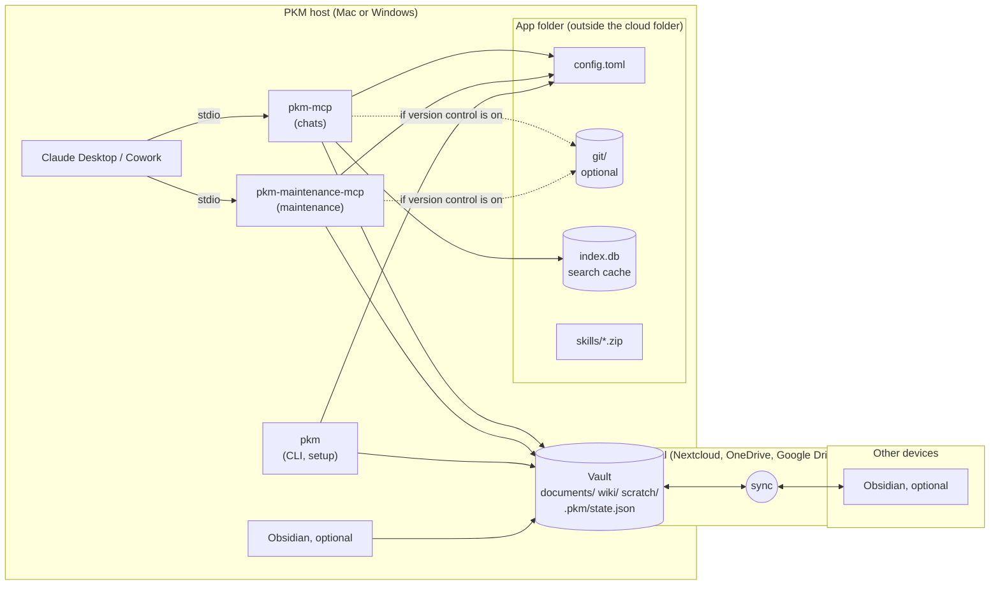

| Component | Role |
|---|---|
| `pkm-mcp` | MCP server for all chats: search, read, create and continue documents, citations, images |
| `pkm-maintenance-mcp` | MCP server for the maintenance project: `begin_maintenance`, `write_wiki_page`, `set_document_metadata`, `rename_document`, `move_images`, `fix_images`, `extract_images`, `finish_maintenance` plus the reading tools |
| `pkm` | CLI for setup, checks (`doctor`, `lint`) and troubleshooting; contains the same maintenance building blocks |
| Skills `pkm-access`, `pkm-wiki` | Instructions for Claude in normal chats and in the maintenance project |
| Vault | Markdown files in the cloud folder (or a local folder without cloud storage); never contains `.git` or the search index |
| App folder | `config.toml`, Git directory, search index and skill ZIP files – outside every cloud folder |
| Git (optional) | One commit per document version; history, diff, restore, revertable agent runs |

All three programs come from one Python package, `pkm-tools`. They do not call an LLM and open no
network connections; the content work is done by Claude in Claude Desktop.

### 1.1 Locations

| Item | macOS | Windows | Linux (tests, CI) |
|---|---|---|---|
| Programs | `~/.local/bin/pkm`, `pkm-mcp`, `pkm-maintenance-mcp` | `%USERPROFILE%\.local\bin\*.exe` | `~/.local/bin/` |
| App folder | `~/Library/Application Support/pkm/` | `%APPDATA%\pkm\` | `$XDG_DATA_HOME/pkm` or `~/.local/share/pkm/` |
| Configuration | `<app folder>/config.toml` (or `PKM_CONFIG`) | same | same |
| Git directory | `<app folder>/git/` (or `PKM_GIT_DIR`) | same | same |
| Search index | `<app folder>/index.db` (or `PKM_CACHE_DIR`) | same | same |
| Skill ZIP files | `<app folder>/skills/` | same | same |
| Claude Desktop configuration | `~/Library/Application Support/Claude/claude_desktop_config.json` | `%APPDATA%\Claude\claude_desktop_config.json` | `~/.config/Claude/claude_desktop_config.json` |

## 2. Installation at a glance

The user runs one command; everything else is guided by `pkm setup`.

| Platform | Command |
|---|---|
| macOS (also Linux) | `curl -LsSf https://raw.githubusercontent.com/achim0x/pkm-llm-wiki/main/install.sh \| sh` |
| Windows (PowerShell) | `powershell -ExecutionPolicy ByPass -c "irm https://raw.githubusercontent.com/achim0x/pkm-llm-wiki/main/install.ps1 \| iex"` |

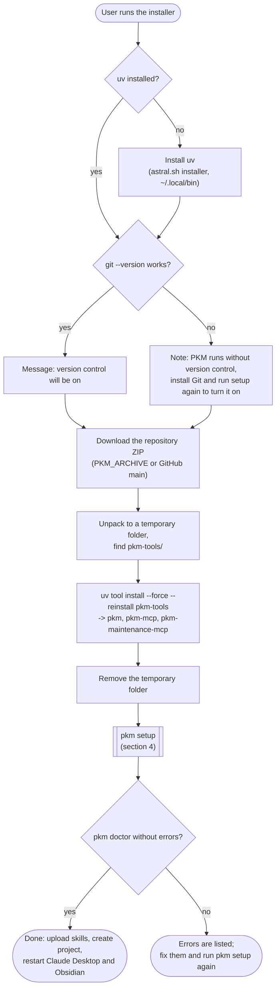

After the installer the user does three things by hand, because Claude Desktop offers no interface
for them: upload the two skill ZIP files, create the project "PKM Maintenance" with the printed
instructions, and restart Claude Desktop (and Obsidian, if used, so that it reads the new settings).

## 3. The installers

### 3.1 `install.sh` (macOS, Linux)

1. **uv.** Uses `uv` from `PATH` or `~/.local/bin/uv`; otherwise installs it with the official
   installer (`curl -LsSf https://astral.sh/uv/install.sh | sh`). `uv` brings a suitable Python, so
   Python does not have to be installed.
2. **Git check.** Runs `git --version`. On macOS `/usr/bin/git` exists even without the developer
   tools but only shows an installation prompt; the check therefore runs the program instead of
   looking for the file. Without Git the installer prints a note and continues. It never installs
   Git itself.
3. **Download.** Fetches the ZIP archive of the repository (default
   `https://github.com/achim0x/pkm-llm-wiki/archive/refs/heads/main.zip`, overridable with
   `PKM_ARCHIVE`, e.g. for a branch or a local file in CI) into a temporary folder and unpacks it.
   The archive is used instead of `uv tool install git+https://…` because that would require Git,
   and uv ignores the `subdirectory` of archive URLs.
4. **Package.** `uv tool install --force --reinstall <unpacked>/pkm-tools` creates an isolated
   environment for the package and links `pkm`, `pkm-mcp` and `pkm-maintenance-mcp` into
   `~/.local/bin`. The temporary folder is removed on exit.
5. **Setup.** Starts `~/.local/bin/pkm setup` and passes all arguments of the installer on. When
   the installer was started via `curl … | sh`, standard input is the script itself; the answers
   are then read from `/dev/tty`.
6. Prints a hint to run `uv tool update-shell` if `pkm` is not found in a new terminal.

The script uses `set -eu`; it fails if a step fails, including `pkm setup` reporting errors.

### 3.2 `install.ps1` (Windows)

Same steps with PowerShell means: `Get-Command uv`, the uv PowerShell installer,
`Get-Command git`, `Invoke-WebRequest` (or `Copy-Item` if `PKM_ARCHIVE` is a local path),
`Expand-Archive`, `uv tool install`, and `pkm.exe setup`. Arguments for `pkm setup` are passed via
`$env:PKM_SETUP_ARGS` because `irm … | iex` cannot pass arguments. If `pkm setup` reports errors,
the script throws (instead of `exit`, which would close an interactive PowerShell session).

### 3.3 What the installers change

Only two things without asking: the installation of `uv` (if missing) and of the package
`pkm-tools`. Everything that touches the vault, the Git configuration or Claude Desktop happens in
`pkm setup`, with questions where existing data would change.

**Updating** means running the installer again: it reinstalls the package from the current archive
and runs `pkm setup`, which changes nothing that is already in place. Afterwards the skill ZIP files
should be uploaded again.

## 4. `pkm setup`

`pkm setup` (module `setupwiz.py`) is an interactive, idempotent wizard. It starts by collecting an
existing configuration from the environment, the `env` blocks of the PKM entries in Claude Desktop
(where installations from before `pkm setup` kept their settings; `is_pkm_entry()` recognizes them
by the names `pkm`/`pkm-maintenance` or by the programs `pkm-mcp`/`pkm-maintenance-mcp`) and `config.toml`,
in this order of precedence, for all keys of `CONFIG_KEYS`. If none of them sets `PKM_ROOT`, the
vault is read from `core.worktree` in the config of the Git directory (`worktree_of()`), provided the
folder contains `.pkm/state.json`. It shows them with their
source and, if confirmed, takes them over as defaults and into `config.toml`; this keeps e.g. a
custom `PKM_GIT_DIR` and so the version history. If declined, an existing `config.toml` is backed up
and the setup starts anew. After `pkm init` (which never overwrites an existing `CLAUDE.md`) the
wizard compares the vault's `CLAUDE.md` with the template of the installed version; if it differs,
it asks whether to replace it (backup to `<app folder>/backups/`, commit with Git) or writes the
template as `CLAUDE.md.new` next to it. An old Claude Desktop entry `pkm-pflege` is replaced by
`pkm-maintenance` in the Claude Desktop step. End of input counts as an empty answer (the default). Every answer can be given
in advance as an option; `--yes` accepts all defaults and confirmations (used by the installers in
CI).

| Option | Meaning |
|---|---|
| `--vault <folder>` | Vault folder (absolute path) |
| `--vault-name <name>` | Name of the Obsidian vault (default: folder name), for `obsidian://` links |
| `--git-name`, `--git-email` | Git identity for the PKM repo if none is set |
| `--language en\|de` | Main language of documents created in chat and of the wiki (`PKM_LANGUAGE`, default `en`) |
| `--yes` | Take defaults, confirm everything |
| `--claude-config <file>` | Path of `claude_desktop_config.json` (default per OS) |
| `--skills-dir <folder>` | Target folder of the skill ZIP files |
| `--json` | Print the result as JSON (messages go to standard error) |

### 4.1 Flow

```mermaid
flowchart TD
    S(["pkm setup"]) --> EX{"existing settings?<br/>environment, Claude Desktop env,<br/>config.toml, Git directory"}
    EX -- "no" --> V
    EX -- "yes" --> EX1{"show them,<br/>take them over?"}
    EX1 -- "yes" --> EX2["adopted values = defaults,<br/>written to config.toml"]
    EX1 -- "no" --> EX3["back up config.toml,<br/>start a new configuration"]
    EX2 --> V
    EX3 --> V["Vault folder:<br/>--vault, PKM_ROOT or adopted value<br/>or a vault above the current folder"]
    V --> V1{"absolute path?"}
    V1 -- "no" --> X1(["config_error"])
    V1 -- "yes" --> V2{"folder exists?"}
    V2 -- "no" --> V3{"create it?"}
    V3 -- "no" --> X2(["config_error"])
    V3 -- "yes" --> V4["mkdir"]
    V2 -- "yes" --> CS
    V4 --> CS["Detect the cloud service;<br/>warn about online-only files"]
    CS --> G{"Git found and working?<br/>(PKM_GIT, PATH, usual locations)"}
    G -- "no" --> G0["Note: no version control<br/>PKM_VERSIONING = false"]
    G -- "yes" --> G1["PKM_VERSIONING = true<br/>PKM_GIT = path"]
    G0 --> L["Language of chat documents and wiki:<br/>--language, previous value or en<br/>PKM_LANGUAGE = en | de"]
    G1 --> L
    L --> W["Write config.toml<br/>(other keys are kept)"]
    W --> I["pkm init:<br/>structure, CLAUDE.md, .gitignore, state.json,<br/>.obsidian/app.json, .obsidian/types.json"]
    I --> R{"version control on?"}
    R -- "no" --> SM
    R -- "yes" --> R1["Create the Git repo outside the vault<br/>core.autocrlf=false"]
    R1 --> ID{"user.name and user.email set?"}
    ID -- "no" --> ID1["Ask for name and e-mail,<br/>set them for the PKM repo only"]
    ID -- "yes" --> GPG
    ID1 --> GPG["commit.gpgsign=false for the PKM repo"]
    GPG --> IC{"initial commit exists?"}
    IC -- "no" --> IC1["pkm init again:<br/>commit pkm: init"]
    IC -- "yes" --> SM
    IC1 --> SM{"CLAUDE.md in the vault<br/>differs from the template?"}
    SM -- "no" --> CD
    SM -- "yes" --> SM1{"replace it?"}
    SM1 -- "yes" --> SM2["back up to app folder/backups,<br/>write template, commit (with Git)"]
    SM1 -- "no" --> SM3["write the template<br/>as CLAUDE.md.new"]
    SM2 --> CD
    SM3 --> CD["Check claude_desktop_config.json,<br/>change it only with permission<br/>(section 4.3)"]
    CD --> SKZ["Write pkm-access.zip and pkm-wiki.zip"]
    SKZ --> PI["Print the project instructions<br/>for PKM Maintenance"]
    PI --> DR["pkm doctor --short"]
    DR --> E{"errors?"}
    E -- "no" --> OK(["Setup finished, exit code 0"])
    E -- "yes" --> NOK(["Errors listed, exit code 1"])
```

### 4.2 Configuration file and lookup

`pkm setup` writes `config.toml` with flat keys named like the environment variables of
specification 7.1, for example:

```toml
# PKM configuration, written by `pkm setup`. Environment variables take precedence.

PKM_GIT = "/usr/bin/git"
PKM_LANGUAGE = "en"
PKM_ROOT = "/Users/name/Nextcloud/Vault"
PKM_VAULT_NAME = "Vault"
PKM_VERSIONING = true
```

`PKM_LANGUAGE` (`en` or `de`) is the main language of documents created in chat and of the wiki.
The servers `pkm` and `pkm-maintenance` read it at start (`configured_language()`, which falls back to `en` if the setting is missing or
invalid, so the server always starts) and appends a sentence to its MCP instructions naming the
language and its section names (`Result`, `Decisions`, `Open points`, `Context / rationale` or
`Ergebnis`, `Entscheidungen`, `Offene Punkte`, `Kontext / Begründung`); `pkm-maintenance`
(`wiki_language_instructions()`) names the wiki sections and the summary label (`Summary`, `Content`,
`Contradictions / open questions`, `See also`, `Citations` or `Kurzfassung`, `Inhalt`,
`Widersprüche / offene Fragen`, `Siehe auch`, `Belege`). The skills `pkm-access` and `pkm-wiki`
follow these instructions; the tools accept both variants. The generated wiki files (`index.md`,
`_status.md`, the heading of a new `log.md`) take their fixed texts from `wikitexts.py` in the wiki
language.

Every program (server or CLI) resolves its configuration the same way:

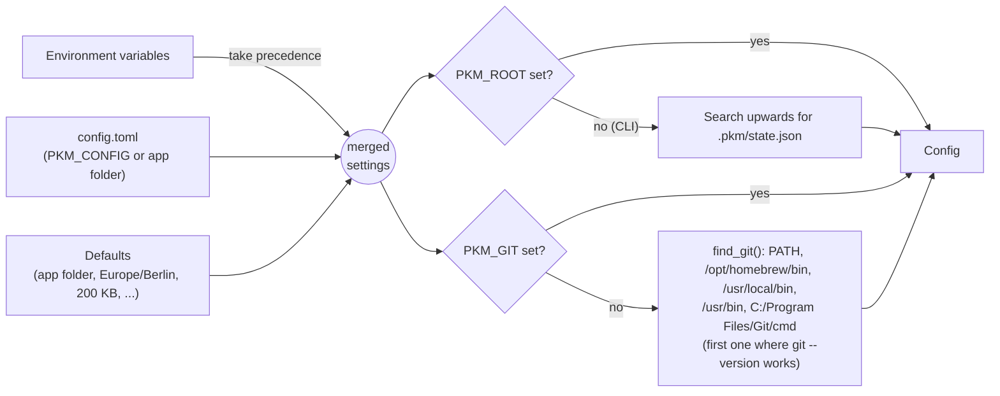

Because the vault path and the Git program are in `config.toml`, the entries in Claude Desktop need
neither `env` nor `PATH`. This matters because Claude Desktop starts MCP servers with a minimal
environment without the user's shell profile.

### 4.3 Claude Desktop configuration

`pkm setup` first checks whether `pkm` and `pkm-maintenance` are already entered as needed. Only if an
entry is missing or different does it show the change and ask **once** whether it may change the
file. If the answer is no, nothing is changed and the entries are printed so that the user can add
them by hand (in Claude Desktop: Settings > Developer > Edit Config). With `--yes` the answer is yes.

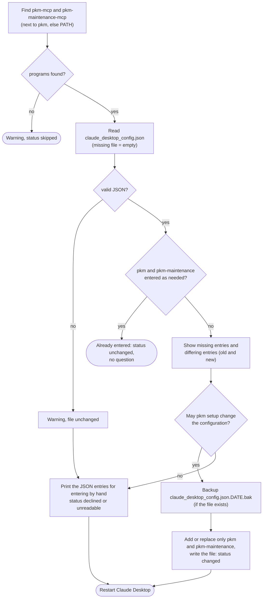

Other servers and all other keys of the file are kept. An entry looks like this:

```json
{
  "mcpServers": {
    "pkm": { "command": "/Users/name/.local/bin/pkm-mcp" },
    "pkm-maintenance": { "command": "/Users/name/.local/bin/pkm-maintenance-mcp" }
  }
}
```

Only if the configuration file is not in the default app folder does `pkm setup` add
`"env": {"PKM_CONFIG": "<file>"}`.

### 4.4 Files created or changed

| File | Created/changed by | Notes |
|---|---|---|
| `<app folder>/config.toml` | `pkm setup` | Merged with existing keys |
| `<vault>/documents/_inbox/`, `wiki/…`, `scratch/`, `pkm_img_import/`, `.pkm/` | `pkm init` | Only missing folders |
| `<vault>/CLAUDE.md`, `wiki/index.md`, `wiki/log.md`, `wiki/_status.md`, `.pkm/state.json` | `pkm init` | Only if missing |
| `<vault>/.gitignore` | `pkm init` | Created, or missing `scratch/` and `pkm_img_import/` added |
| `<vault>/.obsidian/app.json` | `pkm init` | Missing settings of specification 13 added; different values kept and reported |
| `<vault>/.obsidian/types.json` | `pkm init` | Missing property types added; different types kept and reported |
| `<app folder>/git/` | `pkm init` | Only with version control; local `user.name`/`user.email` if asked, `commit.gpgsign=false`, `core.autocrlf=false` |
| `claude_desktop_config.json` (+ `.bak`) | `pkm setup`, only with permission | Section 4.3 |
| `<app folder>/skills/pkm-access.zip`, `pkm-wiki.zip` | `pkm setup` | Built from the skills inside the package |

## 5. Version control is optional

`PKM_VERSIONING` decides whether Git is used. `pkm setup` sets it from the Git check; an explicit
environment variable overrides it.

| Function | With Git (`PKM_VERSIONING = true`) | Without Git (`false`) |
|---|---|---|
| Writing tools | New version, one commit per change (`commit: <hash>`) | New version number, no commit (`commit: null`) |
| `history`, `read` with `version`, `pkm show`, `restore_document` | Available | `not_versioned` with a hint how to turn it on |
| Manual changes in Obsidian | Committed as a version by `pkm versions` (start of each maintenance run) | Detected by `pending` via the hashes in `state.json` |
| `pkm commit-wiki`, agent commit in `finish_maintenance` | One commit for `wiki/` and `state.json` | Nothing to commit (`status: unchanged`) |
| Citations of an older version | Checked against the text of that version from Git | Checked against the current text if the cited section is unchanged; otherwise `newer_version` |
| Write lock | `<git dir>/pkm.lock` | `<cache dir>/pkm.lock` |
| `pkm doctor` | Git found, repo, identity, signing | Note `versioning` (not an error) |

**Turning it on later:**

```mermaid
sequenceDiagram
    actor U as User
    participant S as pkm setup
    participant G as Git
    participant M as Maintenance run
    U->>U: install Git
    U->>S: run pkm setup again
    S->>S: find_git() succeeds, PKM_VERSIONING = true
    S->>G: create repo outside the vault, identity, gpgsign off
    S->>G: commit "pkm: init" (base files)
    U->>M: "Process new documents"
    M->>G: pkm versions: commit every document with its current version ("first version by hand")
    Note over G: From now on every change is a version with a commit;<br/>there is no history for the time before
```

## 6. Runtime: how Claude Desktop uses the servers

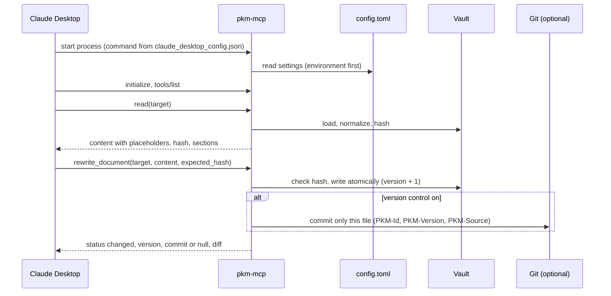

The servers run only while Claude Desktop is open on the PKM host; Cowork reaches them through the
desktop app. `pkm-maintenance` should only be enabled in maintenance conversations, because Claude Desktop
cannot restrict a server to one project.

## 7. Manual installation

For special cases the steps of the installer can be done by hand (details in
[installation.md](installation.md), appendix A):

1. Install `uv`.
2. Install the package: with Git directly from GitHub
   (`uv tool install "git+https://github.com/achim0x/pkm-llm-wiki#subdirectory=pkm-tools"`,
   later `uv tool upgrade pkm-tools`), or from an unpacked ZIP of the repository
   (`uv tool install --force <unpacked>/pkm-tools`).
3. Run `pkm setup` – or write `config.toml` by hand, run `pkm init` and add the two entries to
   `claude_desktop_config.json`.

## 8. Verification and releases

- **CI** (`.github/workflows/pkm-tools.yml`): ruff, pylint and the test suite on Linux, macOS and
  Windows (Python 3.12). A second job `installer` builds a ZIP of the commit with `git archive`, runs
  `install.sh` (Linux, macOS) or `install.ps1` (Windows) with `PKM_ARCHIVE` pointing to it and
  `pkm setup --yes` with a temporary `--claude-config`, and finally `pkm doctor --short`. The tests `test_setup.py` and
  `test_no_git.py` cover the wizard (with and without Git, repeated runs, existing Claude Desktop
  configuration, missing identity) and the operation without version control.
- **Releases** (`.github/workflows/release.yml`): for every tag `v*` a GitHub release with the wheel
  of `pkm-tools` and the two skill ZIP files.
- The one-line installers download from the branch `main`; changes on other branches reach users
  only after a merge (or with `PKM_ARCHIVE` pointing to the branch archive).

## 9. pkm-tools: package structure

`pkm-tools` is one Python package (`src/pkm/`, about 13,800 lines in 40 modules) with three entry
points. The modules form layers; a module only uses modules of the same or a lower layer (lower
modules refer to the service façade and the writer only for type hints, under `TYPE_CHECKING`).

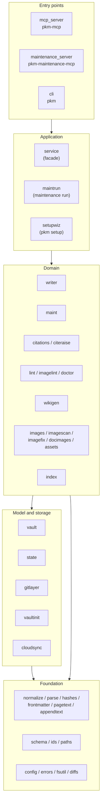

| Layer | Modules | Responsibility |
|---|---|---|
| Entry points | `mcp_server`, `maintenance_server`, `cli` | Thin wrappers: register tools or subcommands, turn `PkmError` into a status, log calls |
| Application | `service`, `maintrun`, `setupwiz` | One method per tool or command; the maintenance run in three steps; the setup wizard |
| Domain | `writer`, `docimages`, `maint`, `citations`, `citeraise`, `lint`, `imagelint`, `doctor`, `wikigen`, `images`, `imagescan`, `imagefix`, `assets`, `index` | Writing with versions, maintenance commands, citations, checks, generated wiki files, images, search |
| Model and storage | `vault`, `state`, `gitlayer`, `vaultinit`, `cloudsync` | Files in the vault, processing state, Git with a separate directory, vault structure, cloud storage |
| Foundation | `normalize`, `parse`, `hashes`, `frontmatter`, `pagetext`, `appendtext`, `schema`, `ids`, `paths`, `config`, `errors`, `fsutil`, `diffs` | Text normalization, sections and hashes (spec 4.8), frontmatter schema (4.1), IDs, safe paths, configuration, atomic files |

Common rules: no network access, no LLM calls, no background processes; every domain error is a
`PkmError` with a machine-readable `status` (e.g. `conflict`, `not_versioned`); files are written
atomically (`fsutil`); all writes go through one lock file.

## 10. Entry points

### 10.1 `pkm-mcp` and `pkm-maintenance-mcp`

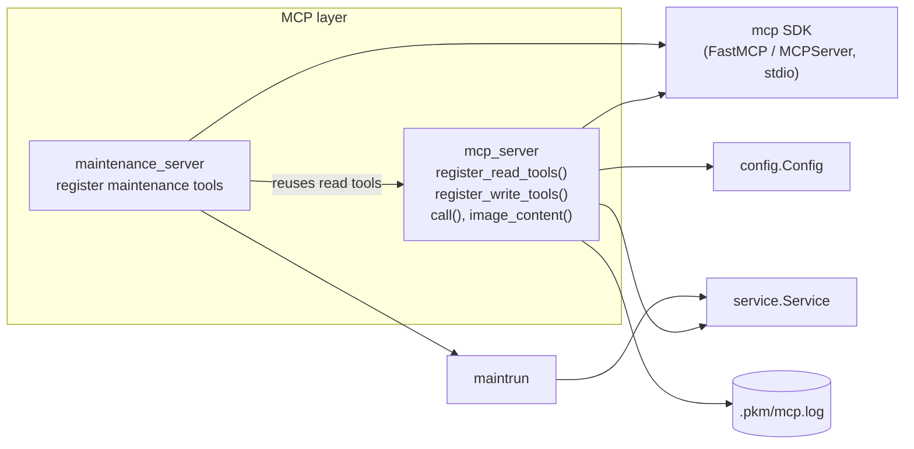

Both servers are built from the same functions: `pkm-maintenance-mcp` registers the reading tools of
`pkm-mcp` (`register_read_tools`) plus the maintenance tools, but none of the document writing tools.
Every tool goes through `call()`:

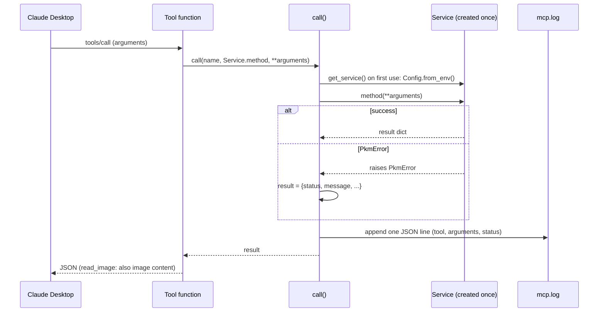

### 10.2 `pkm` (CLI)

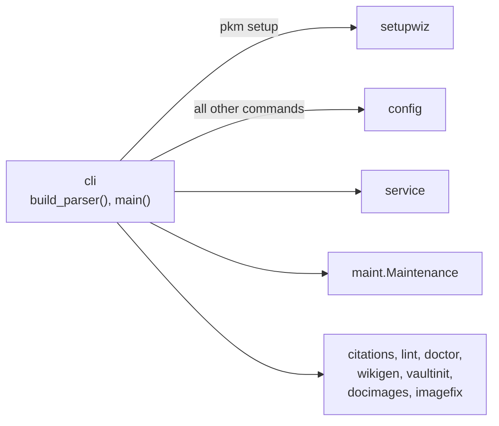

`main()` writes UTF-8 (Windows uses cp1252 for pipes), parses the subcommand, builds `Config` (for
all commands except `setup`), runs the command and prints JSON. The exit code is 1 for any status
other than `ok`, `changed`, `created`, `unchanged` and `proposal`.

## 11. Service and the write path

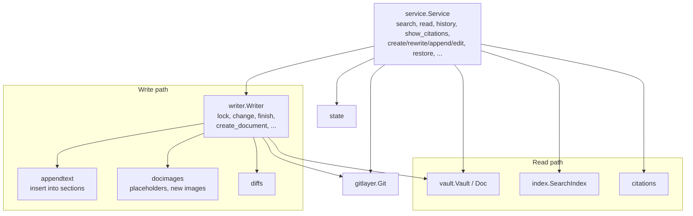

Every changing tool (`rewrite_document`, `append_to_document`, `edit_document`, `add_image`,
`fix_images`, `update_frontmatter`, `restore_document`) runs through `Writer.change()`:

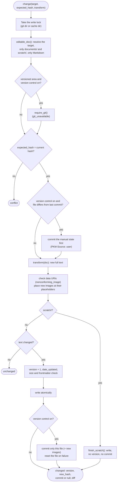

## 12. Vault model, text and hashes

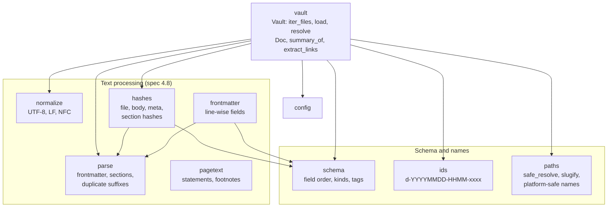

Loading a Markdown file always produces the same normalized view, independent of the operating
system and the editor:

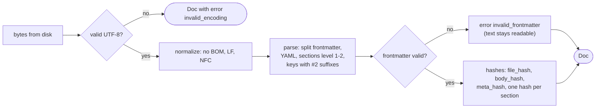

Targets (`target` of every tool) are resolved by `Vault.resolve()` in this order: `id:` (via the
index, otherwise a scan), a path with `/`, a short name (file name without extension), and finally
`short_citation`. Several matches give `ambiguous` with candidates.

## 13. Search index

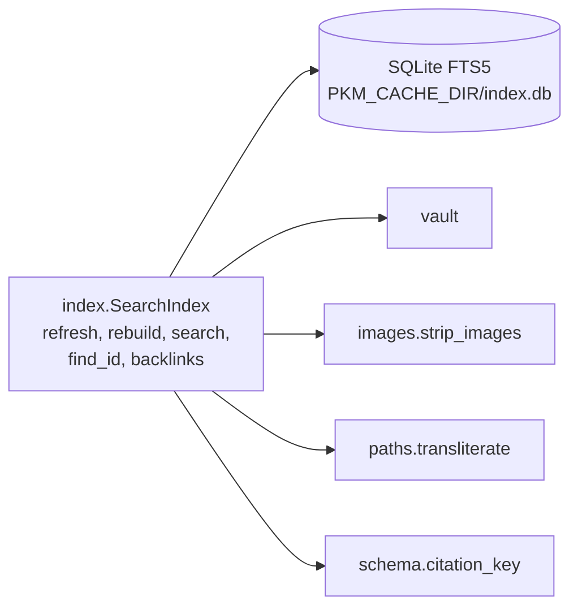

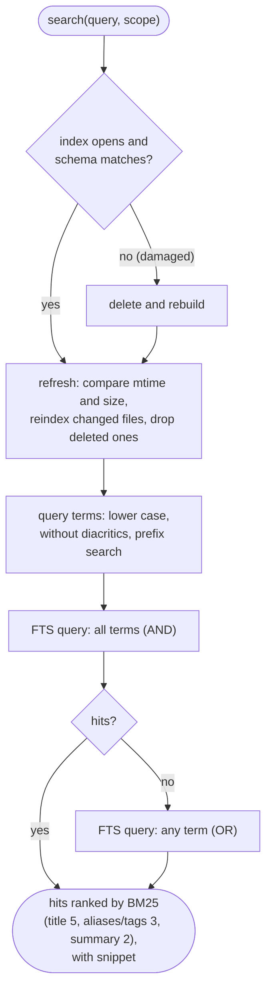

The index is a cache only: it never lives in the vault, can be deleted at any time and is rebuilt
when it is damaged. Text is indexed twice (original and with umlauts spelled out), so "Ueberlauf"
finds "Überlauf". Images are indexed only by their alt text.

## 14. Maintenance and citations

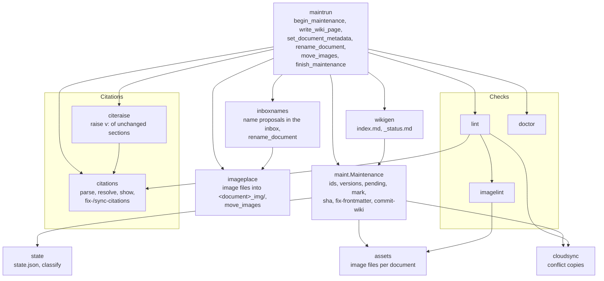

A maintenance run (skill `pkm-wiki`) consists of three tool steps; the content work in between is
done by Claude:

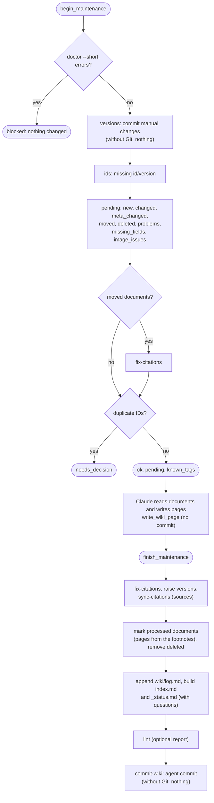

`pending` compares each document with its entry in `state.json` (`state.classify`): equal body and
meta hash means processed; only a different meta hash gives `meta_changed`; otherwise `changed` with
the changed, added, removed and renamed sections. This works with and without Git.

## 15. Images

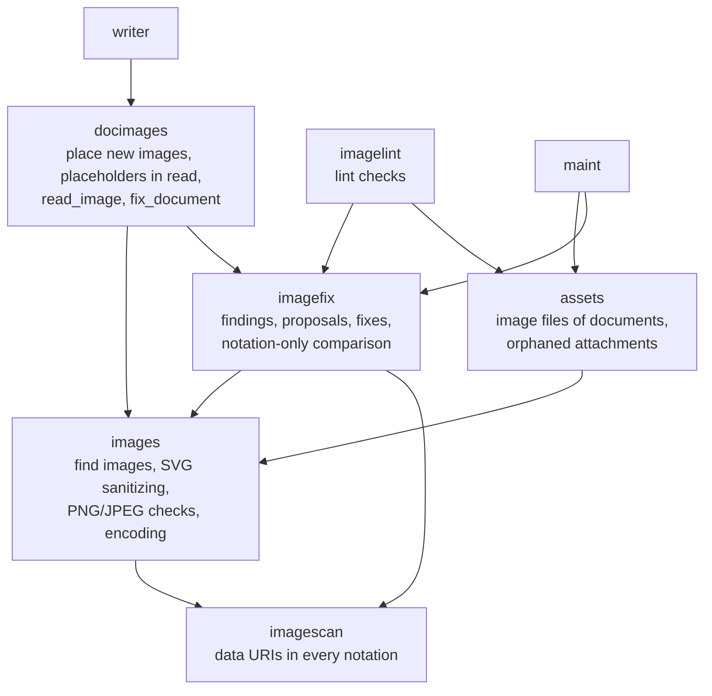

```mermaid
flowchart TD
    A(["writing tool with images or<br/>text containing data URIs"]) --> B["imagescan: find data URIs<br/>(inline, angle, reference, HTML)"]
    B --> C{"new data URIs conform<br/>to spec 4.9?"}
    C -- "no, fix_images not set" --> X(["nonconforming_image with findings<br/>and proposal; nothing written"])
    C -- "no, fix_images: true" --> FX["imagefix: rewrite in the 4.9 form"]
    C -- "yes" --> P
    FX --> P{"image placeholders in the text?"}
    P -- "no" --> W(["continue writing"])
    P -- "yes" --> S["images.prepare_image: read the source<br/>(svg, png_base64, import_path)"]
    S --> CH["sanitize SVG / check PNG, JPEG<br/>(remove metadata)"]
    CH --> M{"mode auto: size up to 24 KB<br/>or area scratch/?"}
    M -- "yes" --> IN["embed as data URI<br/>title pkm:name"]
    M -- "no" --> FI["write file to &lt;document&gt;_img/<br/>(identical file reused;<br/>same commit as the document)"]
    IN --> W
    FI --> W
```

`read` shows embedded images as placeholders ``; when the text comes back,
`docimages` puts the original bytes in again, so Base64 never passes through the model.

**Attachments** (`assets.AssetMap`): every Markdown document's linked images are resolved to files
(relative to the document, from the vault root, ignoring case, by Obsidian's shortest path, by bare
name). A resolved file is an attachment of the document wherever it lies; `pending` reports it with
the document (`images`, `images_changed`), never as an entry of its own, and `finish_maintenance`
skips it in `processed`. Standalone files are classified by path and hash (`maint._pending_files`):
`changed` for the same path with new content, `moved` only if the old path is gone, duplicates
neither; image files that only moved (same hash) appear as `images_moved`, and the earlier text is
compared with the recorded hashes (`assets._recorded_hash`), so a pure move is `image_notation_only`.
New image files go to `config.image_folder(doc)` (`<document name>_img/` next to the document), and
`imagefix.store_image` reuses an identical file there. `imageplace` plans and carries out moving the
image files of a document into that folder (generic names from the alt text, links adjusted, one agent
commit) for `move_images` and `rename_document`; `namelint` reports `naming` (inbox) and
`image_location` (other documents) with the same plan.

**Size limit and extract:** `writeguard.check_size` measures the text without data URIs; frontmatter
changes and `fix_images` skip it, and `confirm_large` (after the user's confirmation) skips it for a
single call of the four writing tools. `writeguard.check_shortening` is the shortening protection. `imagefix.extract_text` (``fix_images`` with ``extract``) writes
embedded raster images unchanged to files; `imagefix.canonical` compares linked files by hash, so the
follow-up run sees `image_notation_only` and `citeraise` raises the citations.

## 16. Configuration, setup and environment checks

```mermaid
flowchart TB
    setupwiz["setupwiz<br/>Setup.run(), build_skill_zips,<br/>find_program"]
    config["config<br/>Config.from_env, ImageConfig,<br/>read/write config.toml, find_git"]
    vaultinit["vaultinit<br/>init_vault, .gitignore,<br/>types.json, app.json"]
    doctor["doctor<br/>environment checks"]
    cloudsync["cloudsync<br/>cloud folders, online-only files"]
    gitlayer["gitlayer"]
    templates[("templates/<br/>CLAUDE.md, gitignore")]
    skills[("skills/<br/>pkm-access, pkm-wiki")]
    setupwiz --> config
    setupwiz --> vaultinit
    setupwiz --> doctor
    setupwiz --> cloudsync
    setupwiz --> gitlayer
    setupwiz --> skills
    vaultinit --> templates
    vaultinit --> gitlayer
    vaultinit --> config
    doctor --> cloudsync
    doctor --> vaultinit
    doctor --> config
```

The flows of `pkm setup` and of the configuration lookup are in sections 4.1 and 4.2. `pkm doctor`
groups its checks into paths (vault, cache directory, cloud folders, online-only files, conflict
copies, import folder, `.gitignore`), Git (only with version control: program, Git directory outside
any cloud folder, repo, identity, signing) and Obsidian (`app.json`, `types.json`); errors make the
status `error`, warnings and notes do not.
