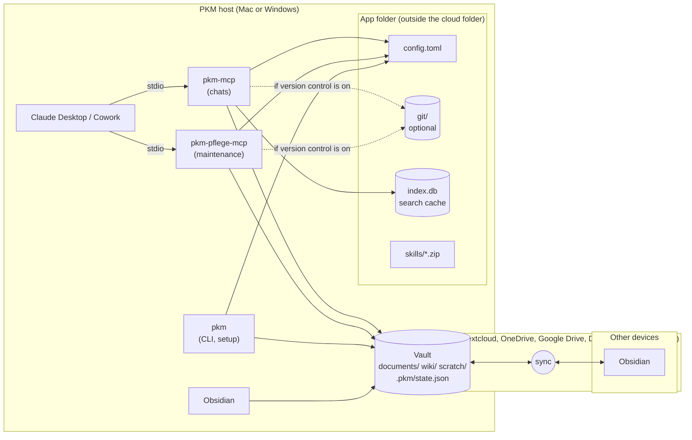
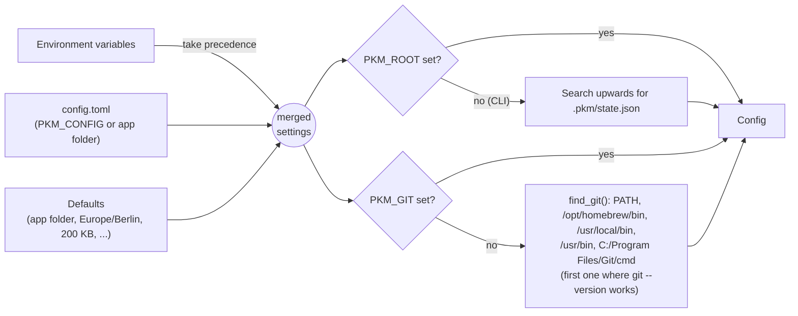
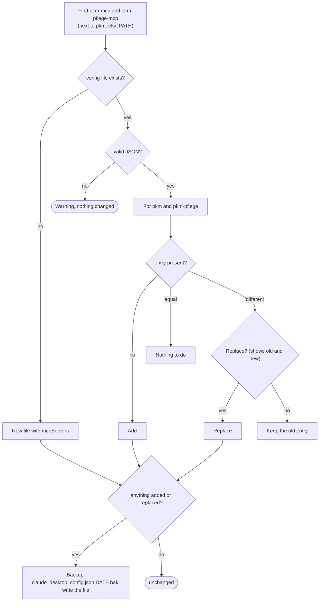
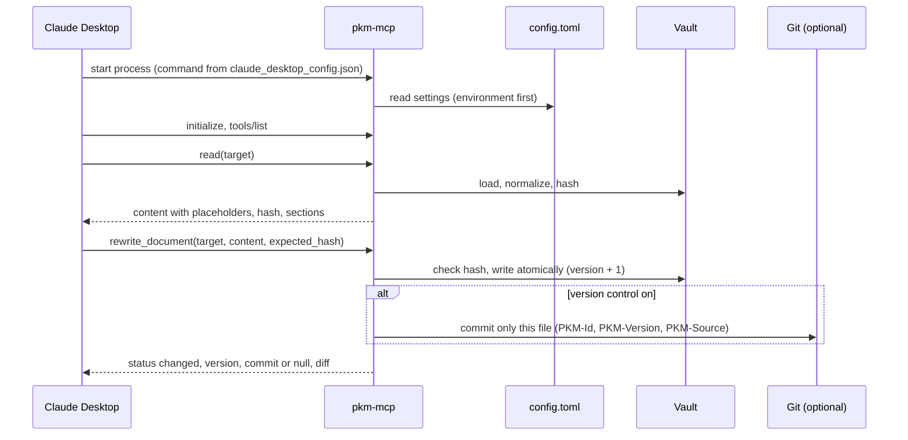

# PKM with LLM wiki – Architecture and installation

This document describes the architecture of the PKM with LLM wiki and, in detail, how it is
installed on the PKM host. The binding requirements are in the (German)
[specification](spezifikation.md), sections 2, 5.4, 5.5, 7, 8 and 15.1; the step-by-step guide for
users is [einrichtung.md](einrichtung.md).

## 1. Overview

The PKM is a folder of Markdown files (the **vault**) that a cloud storage service synchronizes to
all devices. Exactly one computer, the **PKM host** (Mac or Windows), runs everything that writes:
the two MCP servers used by Claude Desktop, the command line tool `pkm` and – optionally – Git for
the version history. Other devices only use Obsidian.



| Component | Role |
|---|---|
| `pkm-mcp` | MCP server for all chats: search, read, create and continue documents, citations, images |
| `pkm-pflege-mcp` | MCP server for the maintenance project: `begin_maintenance`, `write_wiki_page`, `set_document_metadata`, `fix_images`, `finish_maintenance` plus the reading tools |
| `pkm` | CLI for setup, checks (`doctor`, `lint`) and troubleshooting; contains the same maintenance building blocks |
| Skills `pkm-access`, `pkm-wiki` | Instructions for Claude in normal chats and in the maintenance project |
| Vault | Markdown files in the cloud folder; never contains `.git` or the search index |
| App folder | `config.toml`, Git directory, search index and skill ZIP files – outside every cloud folder |
| Git (optional) | One commit per document version; history, diff, restore, revertable agent runs |

All three programs come from one Python package, `pkm-tools`. They do not call an LLM and open no
network connections; the content work is done by Claude in Claude Desktop.

### 1.1 Locations

| Item | macOS | Windows | Linux (tests, CI) |
|---|---|---|---|
| Programs | `~/.local/bin/pkm`, `pkm-mcp`, `pkm-pflege-mcp` | `%USERPROFILE%\.local\bin\*.exe` | `~/.local/bin/` |
| App folder | `~/Library/Application Support/pkm/` | `%APPDATA%\pkm\` | `$XDG_DATA_HOME/pkm` or `~/.local/share/pkm/` |
| Configuration | `<app folder>/config.toml` (or `PKM_CONFIG`) | same | same |
| Git directory | `<app folder>/git/` (or `PKM_GIT_DIR`) | same | same |
| Search index | `<app folder>/index.db` (or `PKM_CACHE_DIR`) | same | same |
| Skill ZIP files | `<app folder>/skills/` | same | same |
| Claude Desktop configuration | `~/Library/Application Support/Claude/claude_desktop_config.json` | `%APPDATA%\Claude\claude_desktop_config.json` | `~/.config/Claude/claude_desktop_config.json` |

## 2. Installation at a glance

The user runs one command; everything else is guided by `pkm setup`.

| Platform | Command |
|---|---|
| macOS (also Linux) | `curl -LsSf https://raw.githubusercontent.com/achim0x/pkm-llm-wiki/main/install.sh \| sh` |
| Windows (PowerShell) | `powershell -ExecutionPolicy ByPass -c "irm https://raw.githubusercontent.com/achim0x/pkm-llm-wiki/main/install.ps1 \| iex"` |


After the installer the user does three things by hand, because Claude Desktop offers no interface
for them: upload the two skill ZIP files, create the project "PKM-Pflege" with the printed
instructions, and restart Claude Desktop (and Obsidian, so that it reads the new settings).

## 3. The installers

### 3.1 `install.sh` (macOS, Linux)

1. **uv.** Uses `uv` from `PATH` or `~/.local/bin/uv`; otherwise installs it with the official
   installer (`curl -LsSf https://astral.sh/uv/install.sh | sh`). `uv` brings a suitable Python, so
   Python does not have to be installed.
2. **Git check.** Runs `git --version`. On macOS `/usr/bin/git` exists even without the developer
   tools but only shows an installation prompt; the check therefore runs the program instead of
   looking for the file. Without Git the installer prints a note and continues. It never installs
   Git itself.
3. **Download.** Fetches the ZIP archive of the repository (default
   `https://github.com/achim0x/pkm-llm-wiki/archive/refs/heads/main.zip`, overridable with
   `PKM_ARCHIVE`, e.g. for a branch or a local file in CI) into a temporary folder and unpacks it.
   The archive is used instead of `uv tool install git+https://…` because that would require Git,
   and uv ignores the `subdirectory` of archive URLs.
4. **Package.** `uv tool install --force --reinstall <unpacked>/pkm-tools` creates an isolated
   environment for the package and links `pkm`, `pkm-mcp` and `pkm-pflege-mcp` into
   `~/.local/bin`. The temporary folder is removed on exit.
5. **Setup.** Starts `~/.local/bin/pkm setup` and passes all arguments of the installer on. When
   the installer was started via `curl … | sh`, standard input is the script itself; the answers
   are then read from `/dev/tty`.
6. Prints a hint to run `uv tool update-shell` if `pkm` is not found in a new terminal.

The script uses `set -eu`; it fails if a step fails, including `pkm setup` reporting errors.

### 3.2 `install.ps1` (Windows)

Same steps with PowerShell means: `Get-Command uv`, the uv PowerShell installer,
`Get-Command git`, `Invoke-WebRequest` (or `Copy-Item` if `PKM_ARCHIVE` is a local path),
`Expand-Archive`, `uv tool install`, and `pkm.exe setup`. Arguments for `pkm setup` are passed via
`$env:PKM_SETUP_ARGS` because `irm … | iex` cannot pass arguments. If `pkm setup` reports errors,
the script throws (instead of `exit`, which would close an interactive PowerShell session).

### 3.3 What the installers change

Only two things without asking: the installation of `uv` (if missing) and of the package
`pkm-tools`. Everything that touches the vault, the Git configuration or Claude Desktop happens in
`pkm setup`, with questions where existing data would change.

**Updating** means running the installer again: it reinstalls the package from the current archive
and runs `pkm setup`, which changes nothing that is already in place. Afterwards the skill ZIP files
should be uploaded again.

## 4. `pkm setup`

`pkm setup` (module `setupwiz.py`) is an interactive, idempotent wizard. Every answer can be given
in advance as an option; `--yes` accepts all defaults and confirmations (used by the installers in
CI).

| Option | Meaning |
|---|---|
| `--vault <folder>` | Vault folder (absolute path) |
| `--vault-name <name>` | Name of the Obsidian vault (default: folder name), for `obsidian://` links |
| `--git-name`, `--git-email` | Git identity for the PKM repo if none is set |
| `--yes` | Take defaults, confirm everything |
| `--claude-config <file>` | Path of `claude_desktop_config.json` (default per OS) |
| `--no-claude` | Leave the Claude Desktop configuration alone |
| `--skills-dir <folder>` | Target folder of the skill ZIP files |
| `--json` | Print the result as JSON (messages go to standard error) |

### 4.1 Flow

```mermaid
flowchart TD
    S(["pkm setup"]) --> V["Vault folder:<br/>--vault, PKM_ROOT, config.toml<br/>or a vault above the current folder"]
    V --> V1{"absolute path?"}
    V1 -- "no" --> X1(["config_error"])
    V1 -- "yes" --> V2{"folder exists?"}
    V2 -- "no" --> V3{"create it?"}
    V3 -- "no" --> X2(["config_error"])
    V3 -- "yes" --> V4["mkdir"]
    V2 -- "yes" --> CS
    V4 --> CS["Detect the cloud service;<br/>warn about online-only files"]
    CS --> G{"Git found and working?<br/>(PKM_GIT, PATH, usual locations)"}
    G -- "no" --> G0["Note: no version control<br/>PKM_VERSIONING = false"]
    G -- "yes" --> G1["PKM_VERSIONING = true<br/>PKM_GIT = path"]
    G0 --> W["Write config.toml<br/>(other keys are kept)"]
    G1 --> W
    W --> I["pkm init:<br/>structure, CLAUDE.md, .gitignore, state.json,<br/>.obsidian/app.json, .obsidian/types.json"]
    I --> R{"version control on?"}
    R -- "no" --> CL
    R -- "yes" --> R1["Create the Git repo outside the vault<br/>core.autocrlf=false"]
    R1 --> ID{"user.name and user.email set?"}
    ID -- "no" --> ID1["Ask for name and e-mail,<br/>set them for the PKM repo only"]
    ID -- "yes" --> GPG
    ID1 --> GPG["commit.gpgsign=false for the PKM repo"]
    GPG --> IC{"initial commit exists?"}
    IC -- "no" --> IC1["pkm init again:<br/>commit pkm: init"]
    IC -- "yes" --> CL
    IC1 --> CL{"--no-claude?"}
    CL -- "yes" --> SKZ
    CL -- "no" --> CD["Update claude_desktop_config.json<br/>(section 4.3)"]
    CD --> SKZ["Write pkm-access.zip and pkm-wiki.zip"]
    SKZ --> PI["Print the project instructions<br/>for PKM-Pflege"]
    PI --> DR["pkm doctor --short"]
    DR --> E{"errors?"}
    E -- "no" --> OK(["Setup finished, exit code 0"])
    E -- "yes" --> NOK(["Errors listed, exit code 1"])
```



### 4.2 Configuration file and lookup

`pkm setup` writes `config.toml` with flat keys named like the environment variables of
specification 7.1, for example:

```toml
# PKM configuration, written by `pkm setup`. Environment variables take precedence.

PKM_GIT = "/usr/bin/git"
PKM_ROOT = "/Users/name/Nextcloud/Vault"
PKM_VAULT_NAME = "Vault"
PKM_VERSIONING = true
```

Every program (server or CLI) resolves its configuration the same way:



Because the vault path and the Git program are in `config.toml`, the entries in Claude Desktop need
neither `env` nor `PATH`. This matters because Claude Desktop starts MCP servers with a minimal
environment without the user's shell profile.

### 4.3 Claude Desktop configuration



Other servers and all other keys of the file are kept. An entry looks like this:

```json
{
  "mcpServers": {
    "pkm": { "command": "/Users/name/.local/bin/pkm-mcp" },
    "pkm-pflege": { "command": "/Users/name/.local/bin/pkm-pflege-mcp" }
  }
}
```

Only if the configuration file is not in the default app folder does `pkm setup` add
`"env": {"PKM_CONFIG": "<file>"}`.

### 4.4 Files created or changed

| File | Created/changed by | Notes |
|---|---|---|
| `<app folder>/config.toml` | `pkm setup` | Merged with existing keys |
| `<vault>/documents/_inbox/`, `_attachments/`, `wiki/…`, `scratch/`, `pkm_img_import/`, `.pkm/` | `pkm init` | Only missing folders |
| `<vault>/CLAUDE.md`, `wiki/index.md`, `wiki/log.md`, `wiki/_status.md`, `.pkm/state.json` | `pkm init` | Only if missing |
| `<vault>/.gitignore` | `pkm init` | Created, or missing `scratch/` and `pkm_img_import/` added |
| `<vault>/.obsidian/app.json` | `pkm init` | Missing settings of specification 13 added; different values kept and reported |
| `<vault>/.obsidian/types.json` | `pkm init` | Missing property types added; different types kept and reported |
| `<app folder>/git/` | `pkm init` | Only with version control; local `user.name`/`user.email` if asked, `commit.gpgsign=false`, `core.autocrlf=false` |
| `claude_desktop_config.json` (+ `.bak`) | `pkm setup` | Section 4.3 |
| `<app folder>/skills/pkm-access.zip`, `pkm-wiki.zip` | `pkm setup` | Built from the skills inside the package |

## 5. Version control is optional

`PKM_VERSIONING` decides whether Git is used. `pkm setup` sets it from the Git check; an explicit
environment variable overrides it.

| Function | With Git (`PKM_VERSIONING = true`) | Without Git (`false`) |
|---|---|---|
| Writing tools | New version, one commit per change (`commit: <hash>`) | New version number, no commit (`commit: null`) |
| `history`, `read` with `version`, `pkm show`, `restore_document` | Available | `not_versioned` with a hint how to turn it on |
| Manual changes in Obsidian | Committed as a version by `pkm versions` (start of each maintenance run) | Detected by `pending` via the hashes in `state.json` |
| `pkm commit-wiki`, agent commit in `finish_maintenance` | One commit for `wiki/` and `state.json` | Nothing to commit (`status: unchanged`) |
| Citations of an older version | Checked against the text of that version from Git | Checked against the current text if the cited section is unchanged; otherwise `newer_version` |
| Write lock | `<git dir>/pkm.lock` | `<cache dir>/pkm.lock` |
| `pkm doctor` | Git found, repo, identity, signing | Note `versioning` (not an error) |

**Turning it on later:**

```mermaid
sequenceDiagram
    actor U as User
    participant S as pkm setup
    participant G as Git
    participant M as Maintenance run
    U->>U: install Git
    U->>S: run pkm setup again
    S->>S: find_git() succeeds, PKM_VERSIONING = true
    S->>G: create repo outside the vault, identity, gpgsign off
    S->>G: commit "pkm: init" (base files)
    U->>M: "Process new documents"
    M->>G: pkm versions: commit every document with its current version ("first version by hand")
    Note over G: From now on every change is a version with a commit;<br/>there is no history for the time before
```

## 6. Runtime: how Claude Desktop uses the servers



The servers run only while Claude Desktop is open on the PKM host; Cowork reaches them through the
desktop app. `pkm-pflege` should only be enabled in maintenance conversations, because Claude Desktop
cannot restrict a server to one project.

## 7. Manual installation

For special cases the steps of the installer can be done by hand (details in
[einrichtung.md](einrichtung.md), appendix A):

1. Install `uv`.
2. Install the package: with Git directly from GitHub
   (`uv tool install "git+https://github.com/achim0x/pkm-llm-wiki#subdirectory=pkm-tools"`,
   later `uv tool upgrade pkm-tools`), or from an unpacked ZIP of the repository
   (`uv tool install --force <unpacked>/pkm-tools`).
3. Run `pkm setup` – or write `config.toml` by hand, run `pkm init` and add the two entries to
   `claude_desktop_config.json`.

## 8. Verification and releases

- **CI** (`.github/workflows/pkm-tools.yml`): ruff, pylint and the test suite on Linux, macOS and
  Windows (Python 3.12). A second job `installer` builds a ZIP of the commit with `git archive`, runs
  `install.sh` (Linux, macOS) or `install.ps1` (Windows) with `PKM_ARCHIVE` pointing to it and
  `pkm setup --yes --no-claude`, and finally `pkm doctor --short`. The tests `test_setup.py` and
  `test_no_git.py` cover the wizard (with and without Git, repeated runs, existing Claude Desktop
  configuration, missing identity) and the operation without version control.
- **Releases** (`.github/workflows/release.yml`): for every tag `v*` a GitHub release with the wheel
  of `pkm-tools` and the two skill ZIP files.
- The one-line installers download from the branch `main`; changes on other branches reach users
  only after a merge (or with `PKM_ARCHIVE` pointing to the branch archive).
